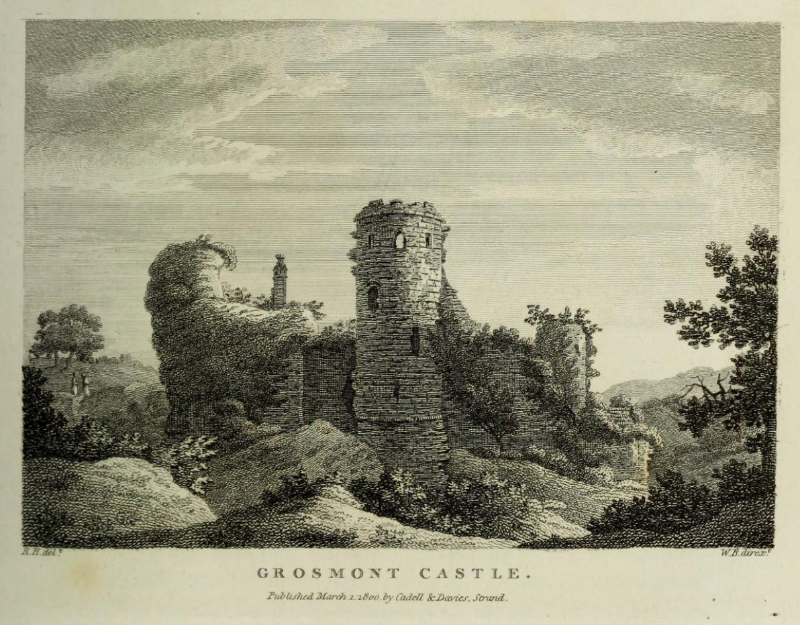
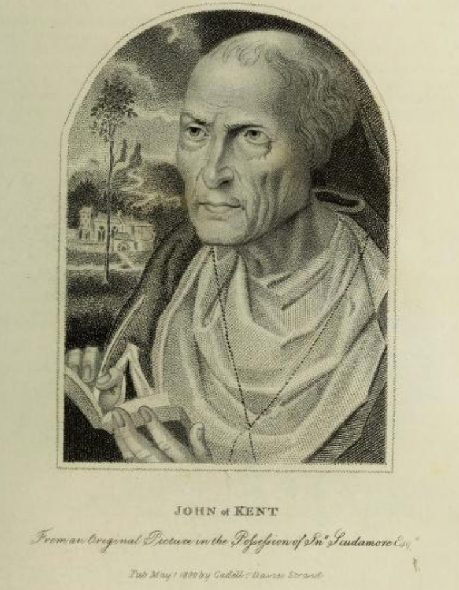

# Monmouthshire Tales

TO DO

See also various tales from Ross

https://archive.org/details/in.gov.ignca.31344/page/351/mode/2up?q=monmouth
p352
Folk-Lore Vol. XVI

Riddle-Story from the Wye Valley.

(*Ante* p. 178.)

"Gone a-hunting; and all the game he kills he leaves behind, and all as he doesn't kill he brings home alive."

The riddle recorded by Miss Eyre from the Wye Valley must be of venerable antiquity, as Homer himself is said to have "given it up." It is found in the *Homeric Epigrams*, a collection of odd scraps which are neither Homeric nor epigrammatic; one or two of the poems (notably the Potters Song and the Eiresione) are well-known to folklorists. The story is told in the Pseudo-Herodotean Life of Homer, with variants in other "lives" of Homer (the references are collected by Abel, *Homeric Hymns*, etc., p. 126 f.). In the course of his wanderings Homer met some fishermen, and on asking about their catch received the answer,

MJTT* AiiriJ/AE-CF l?'' DCTQ. 0 OTJ^ cXoflGV, C^EpQjU£flT^CL

"We have left all we caught, and bring all we did not catch." According to one version, which the Pseudo-Herodotean biographer is at pains to reject, Homer died of vexation at his failure to solve the riddle. It is difficult to suppose that the Wye Valley borrowed from Greece; and the riddle may well have been invented independently. Does it occur elsewhere?

E. E. SIKES.

https://archive.org/details/folklore13folkuoft/page/170/mode/2up
Folk-lore vol XIII,
pp. 170-7
L. M. Eyre. (Margaret Eyre)

Folklore Notes from St. Briavel's.

(Read at Meeting, 26th March, 1902.)

Folklore Notes from St. Brla.vel's.

{Read at Meeting, 26th March, 1902.)

The village and common of St. Briavel's stand on the edge of the Dean Forest, and though the common has long been enclosed, the old castle of the Constables is still the scene of Courts Leet, and the Crown officers go round yearly to spy out encroachments and the ravages of disforestable beasts. Seeing that the forest was at one time a sort of gathering place for gypsies, outlaws, and other turbulent folk, it is only natural that the present race should be small, dark, and untidy, whereas the people of the more fertile country are fair and rather pale. They are all expert poachers, but, outside the mining centres, share little interest in games or sports. Flower gardens, such as delight one in Kent, are

Collectanea. 171

of the rarest occurrence, and generally belong to a " foreigner," that is, any person from another county. Such folklore as I have collected comes from my own village, or from places within six miles' distance. With the miners I am not in touch, and so could get nothing from them.

Tradition has it that St. Briavel, after whom the place was named, was once a Cornish king of such exceeding wickedness that his subjects rose and drove him out. After many wanderings he came to the Wye Valley, and, settling down, became a hermit, acquiring by his holiness great power over the wolves and other wild beasts of the forest. The site of his supposed hermitage is still known. A few stones in a wood go by the name of St. Margaret's Chapel, and to her the church is dedicated, but I have been unable to find out anything more about her. St. Briavel's Wells are three excellent springs on the hilltop, but have no connection with the Saint, who lived in the warm damp valley.

Offa's Dyke runs through the country side and is still plainly traceable, rising in some places to a height of fifteen feet, though almost ploughed away in others. The people call it the Devil's Dyke, but have no stories about it ; nor have I been able to find any meanings for the queer names given to the different parts of the village — such as the Mork, the Meen, or Tumpkin's Ailes.

There are old Roman iron workings near by, with a Devil's Chapel and a Devil's Kitchen ; also a stone put up to commemorate the murder of one of the Constables of the Forest (this bleeds if you stick a pin into it) ; and many other interesting places. These do not, however, belong properly to St. Briavel's.

Of the local omens, charms, folk-medicine, customs and sayings, witchcraft and fairy legends, most will probably be known already to the Society, but one or two things are, I think, new.

First comes the usual list of crows or magpies : one, for ill ; two, for good; three, a disappointment; four, a letter; five, something better; six, a wedding; seven, a burying. But there is a small local variant which says that although one crow in the morning brings ill-luck and two good, yet one after dinner brings good fortune.

If a bee comes into the house, a stranger will soon arrive. In the spring, if you see the first young lamb back first, it is unlucky, you will go backwards all the year.

The small egg first laid by a pullet should never be brought

into the house, but should be thrown over the roof, that the illluck may pass over the household.

When there is a letter in the candle, you thump on the table until the spark falls off — so many thumps, so many days before the letter will arrive.

It is very unlucky to be offered money for any object ; if a fair price be offered you should sell, as ill will come if you refuse.

It is " dreadful bad luck " to put a lanthorn on the table, but if you should have done so foolish a thing, throw salt on the fire, " for if you do waste the salt, you stop the luck." This applies also to other ill-omened actions.

There is a curious and unexpectedly tidy custom of drawing a line of white round the walls of the living-room and round the top doorstep, or the stone sill should there be no steps. The line must be unbroken, for then the evil spirits cannot enter the house.

Should you be troubled by unexplained illness and death amongst your pigs, you should bury the poor victims toes upwards, and the trouble will cease.

There are various death-omens ; for instance, should an owl sit on the roof and whoop, or if a bird enters the house, or even when one " fetches up " against the windows, it bodes ill. " An old man did die along of Louie Jones, and I could not drive that bird away along until him was dead," as an old woman told me in proof of this last omen. A winding sheet in the candle of course bodes ill, and should you hear a sound like the stroke of a stick on a chair, you may be certain that there will be a death in the family shortly. Finally, should it thunder and lighten at a funeral, it does not speak well for the future happiness of the deceased.

Weather sayings are few and commonplace — cats playing about, cows lying down, valley-fog climbing the hill, all mean rain. When the mist lies fiat, there will be hot weather. Pigs can smell the wind, and geese flying over forecast rough weather at sea.

Medicine of course comes naturally to the seventh son of a seventh son, but if your child has whooping-cough, and you do not wish to consult a doctor, wait until you meet a man leading a piebald horse, "and whatever him do say will cure the cough." Or pass the sickly child nine times over and under a bramble that is rooted at both ends.

Collectanea. 173

To secure freedom from toothache you should always carry in your pocket one of those mossy balls that are often found growing on wild rose trees. We used to call them "King o' the Roses." I do not know the real name.^ But if you have toothache, it can be cured by sitting under an ash-tree and cutting your toe-nails.

The forefoot of an unt (or mole) should be carried as a preservative against rheumatism, and a drink of Barrow Well water, on going to bed, is good for a cold.

A Good Friday cake is good for internal troubles. You grate a little into water, and take it so. There is nothing special about the making of this cake, except the date, nor is it cake in the ordinary sense, being merely a lump of dough from the usual baking. The remnants left over are always made into small, flat, cheese-shaped loaves called " batch-cakes," and I fancy the Good Friday cakes are of the same type.

The following charms are used, first, to prevent a wound from festering, the second, to stop the flow of blood. They should be said " over " the injured part : —

Charm for a Thorn. — Our Saviour was born in Bethlehem, pierced with spears, nails, and thorns. Whose wounds never gathered, smarted, nor festered, no more than this thorn. In the name of the Father [etc.]. Amen.

Charm for Blood. — Our Saviour was born in Bethlehem, baptised by John the Baptist in the river of Jordan. Although the waters was wild the waters was good. Christ commanded the waters to stand and the waters stood — so stand this blood. Ribaduck'- go no more. In the name of God, I stop this blood. Amen.

The Local Customs are some of them very commonplace, such as sitting up with a corpse until it be buried, and opening all the windows of the house where it lies, that the spirit may escape. But instead of telling the bees of a death, they lift the hives as the corpse is raised to go to the churchyard. If this be neglected, they will die. On Cox Hill there is a stone, where burying parties always rest and set down the corpse. Up to this point volunteers may carry the coffin, but thence to the churchyard the proper bearers take up their duty.

St. Thomas' Day is locally known as " Gooding Day," for then

' [The gall of the wild rose, formed by the insect Cyvis Rosce, is what is meant. — Ed.]

- I cannot explain this word. It was not given when the charm was repeated to me, but appeared in the written copy sent me afterwards.

Page 172 (188/634)

poor people go from house to house begging : " Please to give against a good day." Wheat for bread was often given.

On Christmas Eve at midnight, the cattle kneel and the rosemary bursts into flower — " people used to sit up to see it, down in the Meen." It is also said that where the rosemary grows well " the mistress is master."

First foot, either on Christmas or New Year's Day, should be a man, for luck's sake.

Those watching in a churchyard between twelve and one at night on New Year's Eve, will see the people who are to die withm the year.

On New Year's Day you should get the newest pin you can and drop it in the water, " because it is the blood of Christ." I can get no explanation of this saying.

There is a very pretty custom that is now dying out, which I can, however, illustrate by an exhibit,^ of presenting on New Year's Day, what they call " The gift." It is an apple set on three wt)oden legs, and having a sprig of box, hung with hazel nuts, stuck into it after the manner of a Christmas tree.

In old days, it used to be customary to light twelve small fires in the cornfields on Christmas Eve that there might be a good crop.

On old New Year's Day you should burn the Christmas holly. On " Soft Tuesday " there should be pancakes. Mothering Sunday is a well-established custom with us, and the following is Fathering Sunday. Sweet cakes are made for both occasions.

Palm Sunday is called " Flowering Sunday," and all graves are dressed with flowers. It is a very pretty sight, and there is some rivalry between the different villages as to which shall turn out the best decorated churchyard. Parties go round visiting from church to church, looking and comparing.^ I was told the origin of the custom is this : " It says in the Bible, that the day Jesus Christ was buried, people strewed palm-leaves on the road

' [See ante, p. 115 ; infra, p. 202 : and the Report of International Folklon Conp-ess, 1891, p. 452. — Eu.]

- [Noted in Wales by Mr. A. J- C. Hare, Life of Baroness Bunscn, ii., 392 ; and a sporadic (?) instance at Albrigthon, near Wolverhampton, Shropshire Folklore, 330. — Ed. I am quite familiar with the custom, which is practised everywhere in Wales. — E. S. H.]

Collectanea. 175

they were taking Him, and made wreaths and crosses of them, and they called it Palm Sunday."

" Cursed is the woman that wash and dry of a Good PMday."

People used to run for dresses and little things at Easter and Whitsuntide, but now we have a regular sort of fair, called the " Revels," at which there are races.

The Society knows, from Mr. Hartland's Gloucestershire Folklore, that we rejoice in a local variant of the Godiva story, and that from the reign of John the Commoners have had certain rights in the free wood of Hudnalls. The Society has also read that it was customary to throw bread and cheese to be scrambled for on Whit Sunday. The connection between the two is this : " The Lady did give it, and the bread and cheese was throwd a' Whitsun Sunday to keep this charter up. People did go round the houses to collect a penny each to buy the bread and cheese."

Ghosts there are in plenty. The Castle naturally has its White Lady and its Man in Armour. At Lindors there is a phantom fiddler. " Things with eyes like saucers " and men in " they old box-hats " are met in the lanes, and funerals are seen at three a.m. of a summer's morning.

Witchcraft is still a power, and I will begin by telling you how to become a witch ; it is fairly easy, as all you need to do is to walk twelve times round a church backwards, at midnight. Then when you are a witch you can " run " as a hare or a rabbit. Witches used to tie the manes and tails of the horses at Lindors. If a witch be refused anything at a house, she will have revenge on the animals or children, and will cause them to bleed to death or become paralysed. To prevent a witch from coming into the house, nail a cross of quicken (hawthorn) behind the door, or a yew stick, and plant quicken-trees near your yards and pig-cotes. To find out a witch, get a piece of leather, and fill it with pins ; stick them in different ways, and burn it. At the time of burning, the person who is the witch will come to the door.

There is now a very malevolent witch in the village of Whitebrook, who brings to sorrow those who do not cheerfully give her whatever she may ask for. One poor woman refused some request, whereupon the dame swore that the ungenerous creature should lose all her cows. Now. she had no cattle. But so great was the power of the curse that she went mad, and wanders about the

Page 174 (190/634)

woods seeking and calling the phantom cows that she thinks herself to have lost.

Again, in St. Briavel's itself, some years ago a cottager offended his neighbours, and one fine Sunday afternoon when he and his family tried to re-enter their cottage after a walk, they found the door so fast shut that it had finally to be broken open with a pickaxe. This was undoubted witchcraft.

The vicar of the neighbouring parish of Newlands one day called his man in from mowing the hay to see to something that was needed in a hurry. To his surprise, instead of coming at once, the man stopped to carefully sharpen the scythe, and to set it aside, edge upwards. On his return he said to the parson, " You don't know why I sharpened my scythe before going? I'll tell 'ee. If I'd ha' left that there scythe unsharpened, look see, and an old witch had come along and seen it, she'd ha' rid that scythe round and round the field, and it wouldn't never have had no edge to cut with no more ! " " And I went from there," said the clergyman, in telling the story, " to the churchwarden's house, and found him, with all his family, standing round making charms to make the butter come."

Old people have told me various tales of witches in their young days ; how they gave charms that were better than any doctor's stuff, and notably one story of how a young girl put up for the night with a widow and her daughter. The cottage was small and the guest shared her hostess's bed. It was a fearful night and the noise of the storm kept the young girl awake. In her restless turning, her hand happened to touch the old woman, who was stone-cold, and in her horror she cried out: "Oh ! your mother be dead." " J^ead," laughed the daughter, " her ben't ^md', her be out and about now ! "

Passing from Witches to Fairies, the belief is weaker. They have not been seen for many years, though they used to dance in the Mork, and were "like little soldiers." But we can boast of one fairy-tale which is, I think, quite local.

There was once a farmer of the name of John Jones, who lived in the Mork. He had had a bad year and was hard put to it to pay his rent, so he decided to sell some cider, and started out with the intention of offering it round. As he left the house he met a man who said, "John, do you want to sell some cider?" "Yes," said John, and after some discussion they settled on a

Collectanea. 177

price. " Very well," said the man, " now this is what you must do. Carry a hogshead of cider down to the Fairy Ring in the Big Meadow, and pour it out there on to the grass within the ring." With that he paid and went away. As soon as he was gone, the farmer began to think what a shame it was to waste so much good cider, and the more he thought the less he felt inclined to do it. He had the money safe, and the Fairy Folk would never know the difference, so when evening came he rolled down a hogshead of water and poured that out within the ring. No sooner, however, did he step outside the ring than he saw the same man who had bargained with him in the morning, very angry and threatening. He cursed John Jones and all his family, saying that as he had tried to cheat, the curse should not be lifted until he and his had lost as much blood as water had been poured down the ring. " And they do say," my informant told me cheerfully, "as how a power o' that family did bleed to death ! "

There is only one nursery rhyme that I have found, and to my mind it explains why some of the local babies look so pale and

sad.

" By, By, Baby Bunting, Your Daddy gone a-hunting, Your Mammy gone the other way To beg a jug of sour whey For little Baby Bunting."

I will conclude with a rhyme obviously composed by our envious neighbours.

" St. Briavel's stands upon a hill. It has a church without a steeple, I^ooks down on the River Wye, With most deceitful people."

L. M. Eyre

https://archive.org/details/folklore16folkuoft/page/162/mode/2up?q=%22notes+from+monmouthshire%22
Folk-lore vol XVI,

FOLK-LORE OF THE WYE VALLEY.
MARGARET EYRE pp. 162-179

FOLK-LORE OF THE WYE VALLEY.

BY MARGARET EYRE.

{Read at Meeting, yth December, 1904.)

The present is the second instalment of folk-lore collected in this district which I have had the honour of reading before a meeting of the Folk-Lore Society, and it does not by any means exhaust the matter gathered in the course of much rambling about the country-side during the last few years.^

I cannot give the names of my informants, for I do not know most of them. My stories were often told by chancemet folk crossing moors, by men stripping bark in the woods, women in little cottages miles from any village, and girls who showed me short cuts from hill to hill. Living, as I do, at the extreme edge of the Forest of Dean in Gloucestershire, and on the borders of Monmouthshire, my opportunities for collecting characteristic folk-lore should be great, for I have three racial districts within walking distance, districts where one would expect to find distinct varieties of folk-lore, if folk-lore follows race.

First, there are the Forest of Dean people of my own immediate neighbourhood — small, dark, and passionate ; descendants of gipsies, squatters, and broken men. Then there are the Gloucestershire people of the rolling cultivated lands and valleys ; they are fairer, larger, and more ordinary. Over the river we come to Welshmen, for

^Folk-Lore, Vol. XIII., p, 170.

Folk- Lore of the Wye Valley. 163

Monmouthshire is to all intents and purposes Wales ; indeed, I have even heard Welsh spoken there. On the hilltops there the ancient Silurians are said still to be found, and the country is covered with moors and great woods, so that race peculiarities might well persist.

But I must in all honesty confess that, as far as folklore is concerned, I have been unable to discover any differences. Perhaps as time goes on my inquiries may lead to some result in this direction, but as far as I can at present see the same superstitions flourish — I use the word advisedly — on both sides of the river. And yet the people are not of the same type, and Offa's Dyke, stretching along the hither side of the Wye, still divides England from Wales.

The chief traces we find of " Racial Differences " suggest another sense of that term. We have many place-names, whose folk-etymology recalls the long-past border wars and commemorates real or imaginary battles. Such are Hewelsfield (Glos.), popularly derived from " Hew and slay " or " Human slay." Again, Beachly, near Chepstow, is supposed to come from the English cry of " beat and slay" as they drove their foes into the water off the narrow tongue of land now bearing that name. At Trelleck (Mon.) is the Bloody Field, on which no crops will grow, nothing but gorse. " Eh, but it have been ploughed again and again, but 'tis no use ; because of the blood spilt there, 'tis no use."

At Redbrook (Glos.) is found a piece of very mixed tradition. There is "a pitched road, all laid wi' hmestone, and stones set on edge ; they do say it was where the Turks, or Romans, or such, did travel, the way they did walk. Some calls it the Roman Road, to go somewhere. They calls it the Turks' Fields."

The village of Trelleck, in Monmouthshire, is specially rich in "Remains." There stand the Three Stones, upright monoliths, the " Tre-leck " from which the place
takes its name: stones which were flung from the top of Trelleck Beacon to their present position by Jacky Kent and the Devil, as Miss Wherry told us in her paper on Monmouthshire Witchcraft.^ The distance is about 2\ miles, but that was nothing to Jacky; "He were always a' flinging stones," I was told, and some of his stray shots used to be found in our own neighbourhood. Legend said his stones could never be moved, but alas ! gunpowder has accounted for one at least on the English side of the Wye.

But there is another Trelleck tradition. If you ask your way to the three stones you will be answered, " The way to Harold's Stones ? Yes, Miss," and then directed. Specially will you be so answered if your informant is at all above the labouring class, and the information will be added that " Harold he did set them up because of a great battle he did win, and if you goes on, Miss, you'll see the great mound where they did bury all the dead." The facts of that battle and that victory are real enough. The late Professor Freeman, in the second volume of his Norman Conquest, under the year 1063, quotes the chronicler Geraldus Cambrensis to this effect, that " Each scene of conflict was marked with a trophy of stone bearing the proud legend, ' Here Harold conquered.' "

It is quite possible that Earl Harold may have taken to himself stones obviously not of his own raising, though there is no trace of an inscription on any of the menhirs at Trelleck. But so definite and detailed is the tradition that one at once suspects a literary source. Prof Freeman is not likely to have lectured at Trelleck — is an acquaintance with Giraldus possible } If so, it is not of recent date. There stands in the church a very curious sundial, bearing the date 1671, which was formerly in the old school-yard. On one face of the pedestal is carved an excellent representation of the three stones, ^Vol. XV., p. 75.

[IMAGE]

with the inscription, " Maior Saxum, hie fuit victor Harald " ; and on another is carved a dome-shaped object, with the inscription, '' Magna Mole, O quot hie sepulte," obviously referring to the neighbouring mound.^

This would at first sight seem to support the idea of literary contamination, more especially as we know that towards the end of the seventeenth century the English language and English antiquities began to be seriously studied by the learned of this country. Still, we have no proof that the benefactor who erected this sundial was acquainted with Giraldus, and, if he were, I cannot think that even the most brazen antiquary would have had the courage to set up such an inscription on the sole authority of the general statement of Giraldus, (who, moreover, says nothing of the mound), had he not had some already-existing local tradition to go upon. I am therefore inclined to think that the connection of Harold v/ith the three stones of Trelleck is a piece of really independent tradition, emphasized and made permanent by an enthusiastic local antiquary. In this connection, I must remind you that there is more than one carved side to this curious and valuable monument. Giraldus Cambrensis made no mention of the mound delineated on the first side, and most certainly he ignored the object shown on the third side, which is to me the most interesting of all. We have here the round basin of a well, with cups, and the inscription, " Maxima Fonte " (the rest illegible), and this represents the Virtuous Wells — wells still resorted to for their curative powers, and as a wishing-well. There are not, I think, many such carvings of sacred wells known, so the man who

^See Plate XVIII. , kindly drawn by Mr. Henry Jewilt from my rough sketch. The whole inscription is apparently intended to be read thus : "Magna Mole, O quot hie sepulte !" (carving of mound) : "Major Saxum. Hie fuit victor Harald," (carving of stones) : " Maxima Fonte, Dom " illegible, (carving of well-circle with cups and flowers).

wished to perpetuate tliis tradition also, must have been something more sympathetic than a mere bookworm grubbing for history.

As far as I can learn, there is no religious legend attached to the Virtuous Wells, though I have heard them spoken of as St. Anne's Well by people who did not belong to Trelleck. There are supposed once to have been nine springs, though but four remain : they are enclosed in a walled area, which has never been roofed in, and is entered by descending steps. It contains two stone benches and two squared recesses, besides that of the chief spring, which is honoured with an arched recess and a round stone basin — very evidently that figured on the sun-dial. The wells are situated about a mile outside the village, nowhere near the stones, and an ordinary stream runs within a iQy>^ feet of them. The various springs are supposed to cure various ailments, if used early in the morning, and fasting. The water of the main spring contains iron, and very nasty it is, as I know from sad experience, having tasted it under the impression that that was the right way to wish. I afterwards learnt that I ought to have dropped in a pebble and wished as it fell through the water.

There is also a tank at Trelleck called the Nine Wells, which tradition assigns as a bathing place to the "nuns" of Tintern Abbey, some three miles distant. They are supposed to have come by a subterranean passage. It is curious that the country folk always speak of the mins, though Tintern was a Cistercian Monastery.

Trelleck is supposed once to have had seven churches, and at very low water it is said that the spire of one of the last buildings is still to be seen at the bottom of a pond in the Green Lane. Now this legend is rather characteristically Celtic, but I will pass on to

Folk- Lore of the Wye Valley. 167

another subject, that of charming, which is one in which our neighbourhood takes a great and lively interest.

We have still living amongst us magic in all its three distinct forms — white, black, and domestic. By domestic magic I mean ordinary helpful charms, where the power lies in the charm itself, and which can be practised by anyone. " Peter sat on a marble stone," for instance, is an universal incantation, helpful in itself, to be administered by anybody. But True Charming — white magic — is a gift, a power in the possession of one person, wise man or wise woman, special, priest-like, not to be used lightly ; communicable only by a species of initiation to those who are likely to use it fitly, and in no wise to be confused either with popular charms or with the evil workings of the devil's servants.

We at St. Briavel's possess a most famous charmer, a man resorted to by the afflicted of villages ten miles distant, both for themselves and for their beasts. And of this man I may boast myself the pupil.

Old Luke Page^ is a partial cripple, but a fine handsome old man, with shrewd clear-cut features and a humorous eye. He is an excellent judge of character, intuitively suiting his methods to his company, but with a very real belief in his own gift. In his early days he was a butcher in good standing, and is a man of some education. When I went by appointment to his cottage I was courteously invited to a seat, and it was explained to me that, whatever I said, I was to give no thanks to himi. Luke and his old woman — a little shrivelled thing, with the face of a hungry bird — sat on either side of the wood-fire, and a weird black hen sat upright like a penguin in the doorway, and watched me with intelligent eyes whilst the charmer spoke gravely and

^January, 1905. — I regret to say that Luke Page has died since this paper was written.

reverently of his art. That I came of four generations of clergy impressed him greatly, and added much to my fitness to receive the power.

" You do want to know how to charm .-' Well, Missy, 'tis easy ; but you must have the love, and you do have to be steadfast. 'Tis only for you to have a liking, and make your mind up, and have a wish to do a body good, and be steadfast. How to do it .'' Well, 'tis like this. Suppose one should come to 'ee, an' they have an arm or a shoulder out. You must know the Christian name, and, if it be an animal, you do give him one. You do get hold of the person, and examines the place and handles it over, wherever the place is, and you will know by your own inside wJiat 'tis when they comes to 'ee. You've no need to tell tJiey nothing nor let others know ; and see here, Missy, 'ee musn't never tell a woman the way, because of halving the power. Then you fetches out the complaint. You got to know the Christian name for it to come right.

" Rub with the right hand and say : ' Father, Son, and Holy Ghost, great God above, send all things right, bone to bone, marrow to marrow, blood to blood, and flesh to flesh, in this right arm of James Reynolds. Send all things right in the name of the Father, Son, and Holy Ghost.' Then you do mention the Lord's Prayer. Da this two or three times all to yourself, handling it. Never say them the charm, say it to yourself"

" And the same if it was scalds or burns or toothache, or anything. You got to be steadfast, and you got to say the Lord's Prayer. The quicker 'tis done after the injury the sooner 'twill come good."

"An' you got to take No Thanks, but thank the Almighty, and keep it to yourself."

" I hear you sometimes write charms .'' " said I.

" O yes, you can write this, or som'at from the Bible for they to carry about, but they must have faith."

Folk- Lore of the Wye Valley. 169

Now I had been told that Luke used to do some protective charming every year for a farmer now dead, in which the burning of salt figured. As this is in itself an evil and unlucky thing, I asked questions, but got no answer save an uncomfortable look. But the little old woman from the other side of the hearth burst out excitedly : " Burn salt ? why, yes ! you can fetch a man wi' that ! If a girl have been wronged by a man, or if you do want revenge, you can fetch him back at midnight. You do make a good fire, and you mustn't speak or let any one stir it. An' as it strikes midnight you do put the salt on the fire, and wishes him back to speak to you. An' as it strikes you finishes, and him will come, aye ! — through water ! ! No poker, no tongs in the corner, or him will take 'em, and stir out the trouble you be making. That'll bring un back, it will, I know, for I did try myself! " Here old Luke broke in, " Don't you do it, don't you listen, Missy. They as are good at charming mustn't do the devil's work, and that's devil's work, that is."

But that the charmer himself sometimes used to burn salt in his charming is certain. I do not know if it was a case of fighting evil with evil, but a farmer's widow told me how in her husband's time old Luke used to come to charm the cattle. He would ask for half a pound of salt and go off alone to the " folder." After a while he would send it back to the kitchen to be burned. But he would not tell what he did.

The same woman told me how he cured one of their farm lads who suffered from nose-bleeding to a dangerous extent. Physicians were in vain, so his mother took him to old Luke. — " Yes Miss, he got out the Bible right enough, and put the key in it, and the boy did turn it round, and Luke did say something, and the boy wasn't to touch it after he turned it round the last time, and the boy did hold the Bible whilst old Luke he did put the key down his back ; and he's never had no bleeding

since, Miss. Luke he opened the Bible where he thought proper." This was about four months ago.

I have been told he sometimes gives written charms, the ink of which is to be washed off and drunk by the patient. He always looks in his ZadkieVs Almanack to find a lucky day. (" Yes, Miss, 't will help 'ee, this book will," he said to me.) That he suits his methods to his company the foregoing details will show, but that his gift is undoubted I could prove by many instances. He is called out to distant farms, and both human patients and cattle are brought to him from all around. Many sick beasts owe their cure to him, and our late doctor had a great respect for his knowledge of herbs and bone-setting.

That the methods of professional charmers were the same in earlier days is shown by the account given me of " an old tiny lady, very funny, who did travel about, a charmer she was. She did catch hold of 'ee, an' 'ee couldn't never hear what she did say. She got it, and she said, ' That'll do, an you'll find my words come true.' "

Charming leads us on naturally enough to the kindred but very distinct subject of witchcraft. Here the stories are endless, for if there be one thing more than another in which we still believe, it is in " Bewitching." Most of the tales one hears are very confused and like each other, and much concerned with pigs.

There is a mysterious Book, supposed to be in the possession of various women, which is the subject of trembling curiosity. A certain Mrs, Reynolds had been doing plain sewing at my aunt's house, and Kate, the maid, was much excited. ' She's the second daughter of old Mrs. Williams." " Oh ! she was called a witch, was not she .'' " " Yes, and her daughters are too, both on 'em. It's Mrs. Reynolds who's the best one, she's got the Book. Did you ever hear why she's out with Mrs. Thomas .'' Oh yes " (very cheerfully), " they did have words, and she did say something over the pig, and it's never picked up since."

Folk-Lore of the Wye Valley. 171

Then thoughtfully, " If I'd known when she was in the house, I'd have asked to look at the Book, I'd often heard of it."

One charming old farmer told me many wandering stories about witches and their ways. " Witches," he said, " oh, yes, they old witches did go about wi' packs on their backs, and if 'ee did refuse un, or make game o' they, why ee'd be sure to be stopped. They'd say, ' Ah ! never mind, / don't need to touch 'ee ' and they did put a spell on 'ee and curse 'ee ; make children spoonies they did, or clubfoot, or bleed to death, and making the poor animals holler and bawl, and oh, my dear ! what should be done to they old women .''

" Now, there was old Harriet Wells. She went in the shape of a pig, she did. Just before she died they shot at her twice. They done it twice, wi' marbles in a gun to prevent her going. But they never hit her. She cursed them all, the man, his wife, and they were all struck wi' illness, and prevented their getting their butter, and their beasts was all nesh.^ So him followed her one night after they shot at her, an' offered her a sack o' corn not to do anything to they again. She took the sack o' corn, but before taking it, her said she must come down to the house to see what was the matter wi' they. An' she brought an old pot an' burnt it on the fire, an' they could never tell what was in it. Then she took the pot an' went off, an' said them could send the corn. Oh, she was a dreadful old woman, always tormenting people. Then there was old Witch Harris ; she did go to a farm asking for potatoes, and was refused, and then for cider. The farmer's wife, she said no, she hadn't got no cider. ' O yes you have, plenty of cider.' ' How do you know ? ' 'Never mind, I do know.' 'Well, my husband said I wasn't to give none away.' ' Ah ! have he t He'll be the first to regret it ! as you'll have three children born who'll

' Nesh = tender, delicate. See Engl. Dialect Did., s.v.
lose as much flesh, blood, and bones as he've refused me cider ! ' And they did, Miss, and they are little tiny things, the Wrens, they calls 'em ; many's the time I've seen 'em, grown men, never no bigger nor a child.

" Old Mrs. Rollins, she was a masterpiece, she was. She did bewitch her son's wife, who took to wandering in the woods, and it took nine men to find her. So they took her to the old witch's house, and they got her in and locked the door up, the husband and the old witch's husband. And the husband had to get the Bible and the key of the door and hand it to the old witch, and he said, ' You give my wife here peace, and unwitch her.' The old witch did do something with the key and the Bible, and she did never go away again."

This is an interesting example of the use of white magic to expel black, rather than a good story. The following is, however, more dramatic. I got it from the late vicar of Hewelsfield, a village adjoining ours, and in the Chase. He was conversing with a clever old cottager, and from the Bible they got on to spirits and kindred subjects, and the old lady grew confidential. " Witches, eh ? They say 'the old witch can't do nothing,' but you and I, we knows ! Why, there was my mother's brother ; ^ his daughter was hired out the first time, a fine beardlywench she was. One day her mistress says to her, ' There's old Mrs. Wurgan coming along.' (Now slie was a witch, as everyone knew.) An' her mistress says, ' If she asks you for anything, don't you give it her.' An' the old witch, she comes to the door, an' she says, ' Will you lend me one of your clean aprons ? ' So the girl says, T haven't got none.' An' the old witch, she did go on awful ! ' You wicked wench,' she says, 'you've got three clean ones, an'

' The elder and less sophisticated people always describe collateral relationships genealogically in this way. Names, too, are very seldom used, and even young people will say " old Mr. A.'s daughter," rather than " Polly A."

^Beardly or burdly = stately, handsome. Cf. Eng. Dial. Did.

Folk- Lore of the Wye Valley. 173

they're lying folded up in the left-hand corner o' your top drawer ' ; an' she did go away, saying she'd pay her out for her lies. An' that girl was taken with the most awful toothache, she couldn't sit nor stand nor rest day nor night, nor eat a bite. So her mistress, she sent for my mother's brother, and he came an' found the poor girl going about with a face as long as a wet week. An' when he came to hear he was in a tearing rage, and said Jie'd see about it, he wasn't going to stand no such. So he went to that old witch's house, and there she was a-sitting by the fire washing her pot. An' he says, ' You take that ill-wish off my daughter,' an' threatens what he'll do if she didn't. An' she asked, "' What can / do about it t ' He says, ' You wish it away.' She says she will, an' mutters to herself, but what she says is, ' Wish it may stay! So my mother's brother he goes back, and finds the poor girl worse than ever. An' he was in a taking, and back he goes, and he takes the old witch an' he shakes her, an' he says, ' You wish it away, or I'll set you on the fire.' She mutters again, 'Wish it may stay,' but this hears her, an' takes her up an' bundles her on to her own fire, an' there he holds her until she shrieks out, ' Lemme up ! I wish it may goV And the pain it did go that very minute; and he got back, and found the girl eating her dinner as smart as ever."

We have also the story of the man with a witch-wife. He was thin but she was fat, and he complained of this. So his wife promised that he should become as well-liking as herself One night she and her witch-friends took him to a neighbouring country-house, and the witches all turned themselves into straws and went in under the doors, which they then opened and let in the man, afterwards securing them again. He was told on no account to speak a word ; the witches then brought up wine and food from the cellar and the larder, and all began to feast, when suddenly the man whispered, " Haven't you any salt ? " on which the

witches disappeared, leaving him behind a prisoner in the house.

This story is, of course, a "commonplace," but it is interesting to find it accepted amongst our local tales, just as a story, without name or place given. Here is a Devil-legend of the same type, which has, however, been localized, though even there the actors are nameless.

" Did you never hear tell of the shoemaker and the Devil.? Well, Miss, they do tell this tale. One night there was a shoemaker going up the Gloucester road, very late it was, and there he did meet a stranger, and they two did get a-talking as they went along. And by and bye, finding as how he was a shoemaker, the stranger asks will he make him a pair of boots. So down he kneels in the road to take the measure, but when he had done one foot, there weren't no other, only a claw! And the poor man he makes as though he didn't notice, and the stranger went off, saying meet him there when the boots was done. The shoemaker went home half frighted to death. Early the next morning him did go to the parson and told him all about it, and what should he do .'' And he said, ' Make him the boots, but don't you go for to take no money for them, not on no account' So when the boots were ready he went to meet the stranger, and the parson, he did come with him to pray. But the parson he stayed at the turn of the road, out of sight behind the hedge, him did. So there stood the stranger, and he gave him the boots. But when the money was offered, the shoemaker he wouldn't take it. And there was a great crash in the hedge, and the stranger rose up in the air and fled away, and there's a great big hole in the hedge to this day. Yes, Miss, him did take the boots." The Devil has a great deal of property in our parts — kitchens and pulpits, and even a portion of .St. Briavel's Churchyard, a waste piece where few are buried, save suicides and such like.

Folk-Lore of the Wye Valley. 175

"That's the Devil's bit, Miss, and don't you be buried there," was said to me by a wellwisher.

Offa's Dyke, locally known as the Devil's Track, runs along the Wye Valley ; but I have found no tradition to account for the name, though there is one, I believe, in Shropshire {Shropshire Folklore, p. 622).

Miss Wherry has told us much about Jacky Kent o' Grosmont, the famous wizard. Though a Gloucestershire man, his fame seems better preserved in Monmouthshire, at least I have heard more about him over the water. There are people who say they have seen his tomb half in and half out of Grosmont Church, from which the dove flew out to show that Jacky had got the better of the Devil to the end !

"Jacky and the Devil, they was always doing things together. They used to carry stones over the bridge just outside Gloucester to build with. There are a lot of old buildings outside of Cheltenham called the Devil's Town, and they do say it was to build that} But if twelve o'clock struck as they was passing the bridge they had to drop them, and you can see them now, a lot of big stones lying about in the field."

The Picked Stone at Trelleck is also rejected housematerial of the Devil's. There is, too, the story of a bridge to be built in one night, on the usual terms, with the usual dog as victim.

Ghosts we have in plenty, and of the most commonplace kind, the ordinary road or lane ghost, taking the form of a black sheep or pig. (I may mention that our pigs are usually of a beautiful pink.) The following is, however, worth repeating. Old Mrs. Pirrett lived in Monmouth whilst her husband was away fifteen years at the Peninsular War, and got her living by brewing, etc.- She had

i?The "Devil's Chimney" on Leckhampton Hill? or Churchduwn Church? ^ Cf. attte, p. 64.
to go and brew at a big house which stood where the Grammar School stands now, by the Wye Bridge. She had to go in the middle of the night, so as not to use the copper when the cook wanted it. She was crossing Wye Bridge shortly after midnight when a coach and four dashed past her, coachman and horses alike without heads, and rushed straight into the river. She went on as well as she could, her knees shaking with terror, and went to the front door, the way she always had to get in at night. A clergyman came and opened it, in a bath of perspiration, and said to her in furious tones, " What do you want here .'' " then, " Come in, for Heaven's sake, quick ! " As she passed towards the back of the house she saw a lot of gentlemen standing in a circle in one of the sitting-rooms. "An' when she came to think of it, she saw as how they must have been laying the ghost she had met." It takes twelve clergymen to lay one ghost.

Belief in the fairies has not yet quite died out, though it is fast disappearing. Still, fairy-tales are yet to be heard, even if rarely, on either side of the Wye, and in Gloucestershire standards are still left at intervals in the hedges " for the fairies to hide in." (A " standard " is a single stem, which is left uncut at the first trimming of a hedge, and which remains, rising like a little tree above the rest.)

About forty years ago there was a girl at Penallt who used to go out every night by her bedroom window to dance with the fairies, always at a certain time, and was back by a certain time. She always left a pail of water by a well-swept hearth for the fairies to boil their kettle, and a loaf on the table. Over "to" Trelleck, a girl told me that the fairies came out from under the toadstools, and danced at the Parkhurst rocks, which shows their good taste, for it is a lovely place. It was also their custom to dance round the Virtuous Wells, notably on

Folk- Lore of the Wye Valley. 177

All Hallows' Eve, drinking the water out of hairbell cups. People used to find these the next morning round the well, withered and thrown away. They used to gather them up and dry them, to use in illness. One churlish farmer dug up the ring, because he " didn't like all them silly tales." The next day, when he came, he found the water dried up, a thing hitherto unknown. And, strangely, it was only dry to him ; other people could get water. He went again in the morning, hoping to find some water collected, and found instead a little old man sitting there, who told him that he was very much displeased at the ring being dug up, and that the sods must be put back at once. When this was done the water came again, but not before.

My next story comes from the Forest of Dean, and was told by the same old woman in Hewelsfield, who was so fluent on the subject of witches.

"There do be them as says there be no such, but you and I, we knows ! Oh ! / could tell 'ee things ! Why, there was my father. Him did come home one night all of a tremble, and his horse as frighted as himself. Him 'ad been riding home through the forest — all covered in dead leaves, the road were — an' when he were well on in the lane, the leaves they did begin to rise up, they did, just a stone's throw ahead o' he, as though the wind were a-whirling of 'em, an' there weren't no wind, 'twas as still as still. They did get up a-twisting and a-twirling, more, and more, and more, an' always just that much ahead. My father him did get that frighted, him did ride hard to get past they, an' the poor horse all of a muck o' sweat. But 'twasn't no use, him couldn't never get no nearer they, for all his riding, they was just that much ahead, an' not a breath stirring. Eh, my father, he was rarely frighted, he was ! "

By this you will see that we hold the common belief

M
that the small whirlwinds which carry columns of dust along the quiet lanes are made by the fairies riding by.

My last story is of the nature of a "droll."

"Farmer Gag he lived at Ruardean, in the Forest of Dean, and he was in arrears with his rent. One day the farmer's youngest son met the landlord, who asks him where his father was. Lad says, ' He's off making a bad matter worse.' Landlord asks, 'Where is your mother ? ' Lad says, ' Baking a batch o' bread as was ate last week.' The landlord asks where his sister was. Lad says, ' In the other room crying over the fun she had at Whitsuntide.' The landlord asks where his brother was. Lad says, ' Gone a-hunting ; and all the game he kills he leaves behind, and all as he doesn't kill he brings home alive.'

"So then the landlord he says: 'Well, if you come to my house to-morrow at twelve, not before nor not after, not coming straight down the road nor across the fields, why, I'll forgive your father the six months' rent he owes.'

"The lad he went the next day, and got there just at twelve o'clock. 'How did you come?' says the landlord. 'Across the road,' says the lad. 'I told you you were nol to come down the road nor across the fields.' 'No more I didn't,' says the lad. 'I didn't come down the road. I rode the old sheep, and he ran from one hedge to the other across the road, all the way, and scratched my face, as you can see.'

"Then the lad he was taken into the house, for to make his explanations.

"'Now, how was your father oft" making a bad matter worse.'' '

"'The cow died, and father he was at the public spending the money as ought to have bought us a new cow,' says the lad.

"'And your mother, who was baking a batch of bread as was ate last week.-' '

Folk- Lore of the Wye Valley. 179

"'So she was ; we hadn't no bread last week, but borrowed from neighbours, and when I met you, she was baking a batch o' bread to repay the neighbours with,' says the lad.

"'And about your sister, who you said was crying over the fun she had at Whitsuntide,' asks the landlord.

"'So she was,' says the lad. 'She had saved some money, and at Whitsuntide she spent it all, and she was crying over that when you met me.'

"'And about your brother's hunting,' asks the landlord.

"'What I said was true,' says the lad. 'When we met, my brother, was under an oak-tree hunting fleas, and all he killed he left behind, and all he did not kill he brought home alive,'

"So the landlord he gave a receipt for the six months' rent that was due."

Margaret Eyre.

 Results
 4 results 

---

Beatrix A. Wherry, MISCELLANEOUS NOTES FROM MONMOUTHSHIRE, pp. 63-67 , Folk-lore vol XVI, March 1905, vol. I https://archive.org/details/dli.ministry.13087/page/63/mode/1up?q=monmouthshire , incl. p66 : Burial Customs —To keep a corpse from swelling a saucer of salt or a turf should be put on the breast and a pan of water underneath. Rue, hyssop, and wormwood should be put in the coffin. Before starting for the burial-ground there should be singing in the house. The corpse should be carried out at the front door feet first, and should then be turned with its face to the east. In Ross funeral cakes made like hot cross buns are baked, and a dole is given to the bearers, consisting of a coin, which may be a penny, sixpence, shilling, or upwards, one for each man. (Mrs. Briton says a relative of hers gave eight half-crowns.) These coins are always given in a pair of kid gloves.

Margaret Eyre, Folk-lore, vol. XVI, no. II, June 1905, Folk-Lore of the Wye Valley, https://archive.org/details/dli.ministry.13087/page/n207/mode/2up?q=monmouthshire. See also: Folk-Lore, Vol. XIII, p. 170-179

https://archive.org/details/publications08britgoog/page/75/mode/2up?q=jack+kent+sorcerer+welsh

Collectanea

FolkLore, vol. XV., p. 75.
Wizardry on the Welsh Border. Beatrix A. Wherry, pp75-87

Wizardry on the Welsh Border.

(Read at Meetings 17th February, 1904)

[The following article, by a young lady who is still at school, is inserted in all its fulness of picturesque detail partly on account of the admirable object lesson it affords in the collection of folklore. Boys and girls have a great advantage in this work in the ease with which they can vanquish the barriers of racial or class prejudice, which are after all the main difficulties to be overcome. Miss Wherry has given fictitious names to her informants, but the genuineness of her narratives must be self-evident to any one who knows the garrulous dramatic visionary folk of the Welsh Marches. Readers will not fail also to note the close correspondence of the relative positions of witch and wise man in Monmouthshire with those of the witch and witch-doctor in Central Africa, as described in the preceding paper. — Ed.]

While staying at a farmhouse in Monmouthshire this summer, I tried to collect some stories about the wise men, ghosts, and superstitions of the place. I was indebted to our landlady, Mrs. Briton, for many of them, but she referred me to an old Mrs. Pryce, who, she said, could tell me more stories than anyone.

I first made the acquaintance of Mrs. Pryce in the stable-yard wishing to sell a "fine oak table." She was a weird-looking figure in her heavy cloak and cottage bonnet, but the most striking feature about her was the curious penetrating brightness of her eyes. Next day we all trooped down to see the table in her cottage at Trelleck. She was more witch-like than ever; so much so that I looked around for the black cat, which, however, was not forthcoming; she gave long histories of the usual six children whom she had buried, also of her quarrels with her landlord. She also wished to sell some chairs, for she said, "I've no need of chairs, being all alone, and I have the bench I used to kill pigs upon, 'twill not be used for that agen, so I may so well sit on it so long as I do live."

Two or three days afterwards she came up for the money for her table. Drawing me mysteriously out of the room she whispered on the stairs, "They're after me for the rent." She got her money and was then prevailed upon to "take a drop o' cider." I then took the opportunity of asking her if she knew anything about Jenkyns, the wise man, in whom I was very much interested, having heard a great deal about him.

"Lor' bless you, me dear," said she, "Why, Jenkyns 'as been a comfort to me all me life. If I ever 'ad a pain of any sort, rheumaticks, toothache, or what ye like, if I'd go to Jenkyns 'e'd always take it away. Anything that were lost, in all the country-side, 'e'd always find it. 'Deed I did miss old Jenkyns when 'e died, and many's the time I've wished 'im back agen."

I asked her what old Jenkyns' appearance was, and gathered that he was an oldish man, with a long dark beard; stooping, and walking with a stick. "He allus wore one o' those box 'ats," said Mrs. Pryce, "an' an old round coat about the house, but when 'e went to town 'e put on a long coat with tails,"

"But have you ever seen any of his charming, Mrs. Pryce?"

"Lor' bless you, yes, me dear," said she; "many an' many a time, but onst in particular I were dreadful skeered, an' I'll tell you all about it. One day one of me brothers had a toothache, so him an' me an' me other brother went up to old Jenkyns to have it charmed away. Jenkyns could charm away anything; many a time, when I've had rheumaticks or pain of any sort I'd go to Jenkyns an' say, 'Oh! Jenkyns, I do feel so bad, take away my pain, do now;' 'an' 'e'd say,' 'Well now, d'ye believe?' 'Oh, yes, I believe,' say I, an' there! the pain 'ud be gone.

"Well, as I was sayin', when the toothache was gone, Jenkyns went out o' the kitchen to fetch a drop o' cider, an' me brother see'd a big, big book on the comer of the table, an' began to look at it. Jenkyns hollers out from the other side of the house, 'Don't you touch that book, or it'll be the worse for you!' When 'e came back me brother says, 'You must have got the Old Man 'imself about 'ere to have such like goings on,' says 'e. Just then there came a great noise in the room above, bowling about the floor, like as if a great big ball were rollin' about 'All right,' says Jenkyns, 'if you don't look out, youll have him a bit closer.'

"With that 'e takes a candle an' blows into it, puts it on the table, an' draws a circle round it. Then the light all burnt dim an' blue, and the whole room got cloudy an' misty. Presently, we see'd a little old man sittin' in a chair next to Jenkyns, 'e was rockin' 'imself to and fro, and squeakin', 'Jenky, Jenky, Jenky!' an' again, 'Jenky, Jenky, Jenky!' Now 'e 'adn't come thro' the door, 'cos that was locked; an' 'e 'adn't come thro' the window, 'cos that was shut an' barred; an' yet there e' was, sittin' in the chair, calling 'Jenky, Jenky, Jenky!' an' 'Jenky, Jenky, Jenky!' Then Jenkyns blew into the candle agen, an' the dim blue light went away, an' the candle burned clear, an' lo an' behold! that little grey old man was vanished.

"'There!' says Jenkyns; but me brothers didn't wait to hear any more; they just took to their heels an' set off home as if the Old Man were after them, leavin' me to follow as best I could. But I believe to this day 'twas the Old Gentleman himself as we saw."

I asked her what had become of the big book, and what was in it, but she did not know, though she thought that the books were left to a nephew who had disappeared. She did not know the contents of them either, but said that "the Bible was a great book with him!" I had no time to ask any more questions, for Mrs. Pryce was launched on another story.

"One day there was a young man goin' to Monmouth races, an' as 'e was passin' 'is field, 'e see'd the cattle 'atin' of 'is crops. So 'e up an' took 'is jacket off an' throwed it over the gate, an druv' 'em off; but when 'e come back 'is jacket was gone. Now there was an 'ooman round there as 'e knowed 'ud take anything, but o' course 'e 'oodn't miss the Monmouth races, an' so 'e went without 'is jacket. But when 'e came back 'e told 'is wife, an' she told 'im to go off to old Jenkyns an' 'e'd get it back for 'im. Well, old Jenkyns 'e said, 'That 'ooman wont rest till she come an' put your coat back on the gate where she took'd it from. But what'll I do to punish 'er?'

"'Oh!' said the young man, 'don't do anything to hurt her, so long as I gets me jacket back.'

"'Well,' says the old Jenkyns, ' 'ow 'ud it be if I was to put the button 'ole on her cheek, just 'ere, under 'er eye?'

"'All right,' says the young man.

"An', sure enough, that 'ooman come'd n' put back that jacket on the gate, where she tooked it from; but ever arterwards she 'ad the mark of a black button-hole on 'er cheek, just beside 'er eye, so as everyone should know what sort of an 'ooman she was."

"But have you seen the mark, Mrs. Pryce?" I said.

"Why yes, me dear," said Mrs, Pryce, "t'was old So-and-so;" and with that she gave me her whole pedigree. "An' many a time have I seen that mark," said she. "Oh, Jenkyns always punished people when they stole things; there was those folk down to Pen-y-van, they had a bad time of it, I'll tell you about that. There was a farmer down by Pen-y-van, an' 'e 'ad a lot o' cider, but that all got stolen by four people. So 'e went to old Jenkyns to see what was to be done. But ole Jenkyns, 'Tisn't no good,' says he, 'the cider's drinked; I can't get it back for you, 'cos it's all drinked; but I'll tell you what I'll do,' says 'e; 'you come along to the green at six o'clock to-morrer evening, an' I'll make 'em dance;' an' sure enough he coom'd, an' there was these four people dancin' away on the green, men an' women. An' they couldn't help it, 'cos old Jenkyns 'ad put a spell on them, an' they danced for two hours for punishment, till 'e tooked the spell off. An' there was hundreds o' people watchin' 'em. Old Ann Griffiths, she told me all about it, how they was dancin' and jumpin' about, an' all the time ready to drop. Old Jenkyns, 'e was a watchin' quite pleased like for some time; then 'e got tired, tooked the spell off an' went home."

"An' it's not the first time 'e's punished people like that," said Mrs. Briton. "Don't you remember that 'ooman at the public down to Grosmont?" and she started on her story, Mrs. Pryce now and then putting in a nod of approval

"One day old Jenkyns was going down town, an' 'e stopped at a public, 'The Cock and Feather,' to get some refreshment 'E asked for bread an' cheese an' beer; when 'e'd finished 'e asked 'ow much it was. 'Oh,' says the landlady, 'lef s see, six an' four's ten, that's tenpence, please.' Jenkyns said, 'twas too much, but 'e paid 'is tenpence an' went off.

"Presently the 'ooman came back into the room an' went up to the place where Jenkyns had been sitting, an' calls out,

"Six an' four's ten.  
Here's off agen.'

"An' she started runnin' round the table, an' when she came back to Jenkyns' place she called out again,

"'Six an' four's ten.  
Here's off agan.'

"An' started ninnin' round agen. Presently 'er daughter came in an' seed 'er mother runnin' round the table an' callin' out, so she knowed she'd got a spell on 'er. She went on like that for an hour and a half, then 'er son came back from work an' see'd 'is mother runnin' round the table, callin' out,

"Six an' four's ten.  
Here's off agen.'

"So 'e said, "Why, mother, what's t' matter?'"

An' she says, 'Oh, I don't know!

"'Six an' four's ten,  
Here's off" agen.'

"So 'e said to 'is sister, 'As so-an'-so been 'ere?' an' she said 'e 'ad, an' 'e said, 'Ow long's 'e been gone?' an' she said, 'Two hour.'

"So 'e went an' caught up old Jenkyns an' tells 'im what was wrong, an' Jenkyns says, 'Serve 'er right for chaigin' a poor man tenpence for a bit o' bread an' cheese. But,' 'e says, 'you go an' look under a candlestick on your mantelpiece; there you'll see a bit of paper. Don't you look at it or it'll be the worse for you, but throw it in the fire. An' I hope this'll be a lesson to yer mother.'

"So the son went home, an' there was 'is mother, still runnin' round an' calling out,

"Six an' four's ten,  
Here's off" agen.'

"'E ran to the chimney-piece, there was the paper! an' 'e throwed it in the fire; 'is mother dropped into a chair, all exhausted like. An' it served 'er right."

Mrs. Briton stopped, quite exhausted, for she had been acting the story herself all the time, rushing round the table and shouting,

"Six an' four's ten,  
Here's off agen."

Mrs. Pryce and I were simply screaming with laughter, and it was some time before Mrs. Pryce went on, with a rather disjointed story about a witch:

"One day some folk came to old Jenkyns about a witch; they told 'im 'ow she used to turn herself into a hare an' stand on an old gate-post an' frighten folk terrible. Once there was some men goin' by an' they see'd 'er on the post, an' she called out

"Pee wow, pee wow!' and jumped down; an' they all runned away. So old Jenkyns he says, *You follow after her,' says 'e, 'an' stick a knife into 'er *third 'eel-mark*, then you'll be rid of her.' Now this old witch had put a spell on a woman in the village, so 'er husband an' 'er brother said they'd pay 'er out.

"They see'd the old lady goin' along the road one day, an' so in the third heel-mark from where she was they stuck a knife into the ground. She set up such a screechin' you could a' heard it for miles. 'Oo told you to do that' says she, an' begins sayin' things most awful. Then she went off limpin' like, as if a knife was put right thro' 'er foot So you see old Jenkyns 'e knew 'ow to settle witches, 'e did. Twas a pity he never see'd them on the Buckle. I'll tell you about them.

"One day there was a man going down the Buckle pitch, an' as 'e was goin' along, all of a sudden 'e 'eard sumthin' a comin' down behind 'im, an' 'e looked an' there 'e saw an old 'ooman a comin' gallopin' down the pitch on a piece of an old hurdle. She come right past 'im, an' 'e tried to catch hold of the hurdle; but no, 'e couldn't touch it, nohow. Then there came along another old hag, leppin' an' gallopin' on a ladder, an' behind her came another, as I'm alive, trundlin' on a common grindstone! They came right past 'im, an' on to a public beyond the pitch, an' there they stopped, an' them that wasn't too frightened tried to shoot 'em, but no, nothing couldn't touch 'em, nobody could catch hold of that hurdle, nor the ladder, nor the grindstone neither; an' presently they called, 'Pee wow. Pee wow!' 'an' was off again, so as nobody couldn't stop 'em."

"Well, now I'd like to have seen that," said Mrs. Briton. "I expect you'll be practising on one o' them old grindstones, won't you, to see if you can get along same as the witches?"

"Talkin' of witches," said Mrs. Pryce, "there was a wise woman way over the mountains some time ago, as I heard tell of. She could find anything that were lost. One day there was a man that had a very fine watch, an' 'e put it on the table one day while 'e went to clean 'isself, an' when 'e come back 'twas gone. So 'is mother went off 'way over the mountains to this old 'ooman. Jes' as she came up to the door a little dog run out barking. Then there came out a little, little old 'ooman. 'Don't you be afraid o' the dog,' says she; 'I know what you's come about. Twas your own niece as took the watch. You go back 'ome an' look under the stone next the pump in your scullery, an' there youll find it,' says she. 'An' will you have 'er that took it punished?' said she. But the 'ooman thanked her, and said so long as she got the watch back, she didn't care to punish any one, much less her own niece. So she went back, an' there sure 'nough she found the watch under a stone in the scullery. Now, weren't that strange, as the old 'ooman who'd never seen the place should know where the thing was?"

This was the last story Mrs. Pryce told me. Mrs. Briton, however, remembered some more about Jenkyns, and one day, when I was mangling for her, she told me the following:

"One day old Jenkyns was comin' up from Monmouth, and just on the pitch by the station was four horses strugglin' an' strainin' to drag a great piece of timber up the hill. They were pullin' an' men were pushin', an' then they'd be pulled back by the weight of it Jenkyns, he looked at them for some time, then he up an' shouts, 'Unhitch that fore horse!' So they unhitched him, 'cos nobody dared disobey anything that Jenkyns told them to do. 'Now hitch 'im on behind,' 'e said; an' so they hitched 'im on behind. Then Jenkyns tooked the whip, cracked it, an' shouted, 'Now, me lads, all together!' An' would you believe it, them 'orses that couldn't move a step before, galloped up the hill like a top spinnin', an' the leader dancin' behind!"

Another day I cornered Mrs. Briton in the dairy, and bargained for a story. "Well," she said, "I'll tell you what I know 'bout old Sarah Griffiths. They used to say she was a witch, an' this was told me by old Jacob Jones 'isself, an' 'e ought to know. So if it's a lie, it's 'is own lie.

"It 'appened when Mr. Mason was livin' at the Argoed. 'Is gardener was very particler 'bout havin' turf from the 'ill, an' they 'ad ter bring it across the river in boats, an' old Tom Griffiths an' Jacob Jones, they was 'elpin'. Well, on the last day, when they'd got it all up, Mr. Mason's gardener, 'e left some money down at the Boat Inn, so as they should 'ave some beer, 'cause 'e was pleased they'd brought the turf up so quick. So Tom, when 'e went up to tea, 'e says to Sarah, 'e was goin' down for an hour, cos they was goin' to 'ave some singin' down at the 'Boat'; but Sarah, she said, 'Thee shassent go down theer; thee'st better stay at 'ome 'an 'ave thee's supper.'

"Well, Tom, 'e would'nt stay, so she said, 'If thee goes down theer, thee bis'nt comin' 'ome to-night' An' she began to curse an' swear, an' say she wished the devil 'ud run off with 'im if 'e went down, but still 'e went.

"Well, 'e was a comin' up again, about ten, with old Jacob Jones, an' Jacob was a little way in front; 'e was a tellin' me about it arterwards. 'E said, 'It's as true as my hand's there,' 'e said, 'I felt myself goin' up, up, an' it took me breath away, it was so swift, an' I went up right over the hedge.' It were one of those 'igh 'edges all over dog-briars an' blackberry branches. An' 'e went right over, sheer down into the meadow the other side. Presently 'e 'eard some 'un swearin' close by, an' 'e said, 'Tom, is that thee? What f devil art doin' theer? 'An' Tom said, 'Jacob is that thee? What t' devil art doin' heer?'

"An' then they tried to get out, but they couldn't, an' they was all scrat about, an' bruised, an' cut, an' try as they might they couldn't get out, they was so buried in briars an' brambles. They lay there swearin' an' talkin' to one another till half-past five in the mornin', when they 'eard Dan an' Tom, their two boys, comin' up home from the dnworks. Then Jacob 'e called out 'Lor' bless thee, Dan, is that thee? Coom an' get us out o' this!'

"An' them two boys 'ad the greatest difficulty in gettin' 'em out, they was so stuck in them briars an' things. But at last they got out, an' when they got 'ome, there was old Sally boilin' the kettle, an' she said, 'I telled thee, Tom, thee oosn't come 'ome, an' thee didn't'

"There's another story I've just remembered about a witch," said Mrs. Briton; "I'll just tell you about it.

"There was an old witch used to live 'bout here, an' she had a daughter. Now there was a young man very fond of this girl, and wanting to marry her, but her mother hated him, and would have liked to have put him out of the way if she could.

"One day he came up to see his sweetheart, and there was her mother a brewin' somethin' in a saucepan on the fire. She says, 'Tom, do 'ee take t' kettle an' bring me some water from the well.' But the girl called out, 'Don't 'ee go, Tom. Oh! don't 'ee go.' 'You be quiet, ye interfering hussy,' says the old 'ooman. 'Here, Tom, take t' kettle.'

"So Tom took the kettle an' went off to the well, an' dipped it in; but 'e felt somethin' a pullin' an' pushin' him till it got 'is 'ead right under water as 'twere tryin' to drown him. O' course 'e struggled and kicked till 'e got 'is 'ead up again, an' then 'e looked round to see who 'twere, but there — there war'nt no one.

"'E couldn't see no one, but in two minutes somethin' had 'im again and got 'im under the water, an' all this time 'e couldn't get the kettle filled anyway. Three times 'e were took an' dipped in the well, an' it were a wonder 'e weren't drowned, for 'twas all 'e could do to keep 'is 'ead up. At last 'e got the kettle filled an' went back to the cottage.

"There was the old 'ooman still brewin' in the saucepan an' mutterin' to herself; but when she saw 'im that she thought was drowned come to the door with the kettle full she stopped all of a sudden an' looked at 'im that awful, an' a sort of a horrid laugh came out of the saucepan, an' the lid jumped off an' flew right up the chimney so as all the kitchen was filled with smoke an' the most awful smell. Then 'e knowed she 'ad been brewin' spells to kill 'im, so 'e dropped the kettle an' took to 'is 'eels, an' all up the road 'e could 'ear 'er cursin' 'im, an' I take it 'e was glad to get 'ome. But 'e never went after that girl agen."

Mrs. Briton is one of the few people from whom you can get ghost stories first hand; they are rather vague, but she believes in them implicitly.

"One day," she said, "our cattle got lost an' our two boys went out to look for them. They was out for hours an' hours, an' towards evening Bill Roberts brought the cattle home, but 'e 'adn't seen them boys. So I began to get anxious like, an' I went out all over the place huntin' an' callin' for them. At last it got quite dark, an' I was in an awful state o' mind: I put a lamp in the window to guide them if they was to come back, an' went out with my father to look for them again. We was just goin' past the house of a wicked, wicked old man what had just died (they told all kinds of stories about him, some said as 'e had killed 'is own wife); as I was sayin' we was passin' this house, an' I saw just beside me a big, big, black dog, as large as a calf, an' 'is eyes shone like lumps of fire. My father hit at it with 'is stick, an', would you believe me, the stick went right through it, an' 'twas still there!

"Bye-an'-bye, when we'd passed the house, the dog disappeared.

"'That's a sure token,' says my father, 'that them boys is in the river!'

"Well, you may believe that made me feel bad, but when we got 'ome the lamp was gone out of the window, an' I rushed upstairs, there was the boys fast asleep. Next momin' they told me how they'd got so tired an' gone to sleep in the road, an' woken up when it was dark an' come on home. But that day a telegram come to say as my brother 'ad been killed by a railway truck. So, you see, it was an omen, seeing that there dog."

There is a funny old house on the way to Penallt called the "Potash"; it is said to be haunted, but Mrs. Briton is the only person I have met who has seen anything there. This is her account:

"One night about twelve o'clock I was goin' along the road down to Mitchel Troy, where we used to live; I was just nearin' the 'Potash' when I heard like a lot of people talkin' in the air. First I thought 'twas the gypsies, but as I was comin' by the hedge in the field I saw a sort of a black cloud comin' thro' the gap, an' I heard a sound of dankin' chains, but all at once I knowed it wasn't gypsies 'cos they weren't there, an' I heard voices all around. I ran, an' ran, I was so frightened, till at last I fell right into a sand pit at the bottom of the hill."

Some other members of Mrs. Briton's family have seen visions too. Her son, Samuel, told me that one night, goin' up through Troy Woods, he had seen a great black beast with flaming eyes, and when he turned his lantern on it, it vanished with a sort of screech into a ditch.

Mr. Briton is said by his wife to have seen a black dog going nine times round a tree; I don't know if that is true, but after much cross-questioning, and with additions from Mrs. Briton, I made out that he really had seen something one night, when going to see his wife, who was nursing a sick woman in a him some way off. By the side of the road he saw a lady, dressed in a very old-fashioned way, holding her skirt up; her hair, of a sandy colour, was divided and arranged in two knots on the top of her head. Though it was a pitch-dark night he saw her plainly, and said "Good night;" but she passed him without speaking, and vanished up the road. Mr. Briton riished into the farm where his wife was, and told her be had seen the devil.

"Had 'e got a tail?" said she, laughing.

"No, but 'e had horns," he said; for he thought she had, from the way her hair was arranged.

"You should have followed her, and she'd have shown you a treasure if you'd asked her in God's name what she wanted," said Mrs. Briton sagely; and he wished he had.

"But, why did you think she was the devil?" I asked him. "Oh, I s'pose 'twas just a wicked thought of mine," he said.

I gathered some stories from Mrs. Briton about a mythical person, supposed to have come from Kentchurch `[TH: near Grosmont]` near by, who went by the name of Jack Kent. He is associated with the Druidical stones at Trelleck, and the cleft on the Skyrrid.

"They say that when Jacky was a little boy he made a compact with the devil, which enabled him to do anything he set his hand to.

"Once he was engaged by a farmer to scare crows; but there was a fair going on in the town, and Jack didn't mean to miss it, so he called all the crows together from all the fields round, and when they were all collected he sent them into an old barn, with no roof to it. But Jack put the crows in there and said something to them, and they couldn't get out, try as they might So Jack, he went to the fair, but when he had been enjoying himself there a bit, he met his master. (Now his master had specially told him he was not to go to the fair, or else the crows would be after the crops.) So the farmer said, 'Hullo, Jack, what art doin' here? Didn't I tell thee to look after th' crows?' But Jack says, 'T' crows be all right, master.' And he took the farmer to the old barn, and sure enough there was the crows, and they couldn't get out, altho' that barn had no roof, until Jack told them to. `[Cf. Folklore Journal, i., 370 [TH: actually, 379] (where Kent is misprinted Rent); also vol. ii., p. 10, and F. Hindes Groome's In Gipsy Tents (Nimmo), p. 11, whose version of the story has been heard in Shropshire also. — Ed.]`

"Jack bested the devil in everything. One day they were walking through a turnip-field, and Jack made a bet that he could get more profit out of the field, if they shared it, than the devil could. (The turnips weren't above ground then, but Jack knew they were there.) Jack asked the Old Boy if he'd have Tops or Bottoms. He said 'Tops,' so Jack got the turnips and the Old Boy the greens.

"Next year the Devil took the bet again, an' this time he made sure he'd win, so he said he'd have Bottoms; but Jack, be had took precautions, an' that field came up wheat, so he got the corn an' straw, an' the Devil got the roots, which of course wasn't much good.

"Then they went to threshing. Jack was to have Bottoms this time, so he got the barn floor, and the Devil went on top; so he put up a hurdle for the Devil to thresh on, and as he battered away Jack had all the corn on the floor.

"Then they made a bargain that Jack was to build a bridge over Trothy Weir, Grosmont, before the cock crowed in the morning, but Jack did not before the cock crowed, and there the stones lie to this day, many a ton.

"Jack did some wonderful things in his time. Why! one day he jumped off the Sugar Loaf Mountain on to the Skyrrid (and there's his heel-mark in the Skyrrid to this day). An' when he got there he began playing quoits, he pecked (threw) three stones as far as Trelleck, great, big ones, as tall as three men (and there they still stand in a field), and he threw another, but that didn't go quite far enough, and it lay on the Trelleck Road, just behind the five trees, till a little while ago, when it was moved so as the field might be ploughed; and this stone, in memory of Jack, was always called the Pecked Stone.

"The Devil swore he'd have Jack's soul whether he were buried inside or outside the church; but when Jack died he was buried just under the wall of Grosmont Church, with his head inside and his legs outside, and a great stone (which has since been moved) was put to mark the place. So the Devil never got him."

In Monmouthshire there is a curious custom called "New Year's Gifts." On New Year's Eve the village children bring round apples, with three sticks for legs, and surmounted by a sprig of box adorned with hazel-nuts, fastened on by slitting the nut at the top and inserting a leaf of the sprig. I have heard, too, that in the spring, when the crops are just beginning to sprout, the men go into the field, taking cider with them, light a fire, and "say something" over the corn. On Good Friday it is right to bake a small loaf, which is to be kept till the same date next year; it will not go bad. Some of this loaf ground up is a certain cure for various illnesses.

Mrs. Briton says that if you kill an adder, and before sundown hold it over a flame of fire, its four legs will come out. She has seen it!

Beatrix Albinia Wherry.

https://archive.org/details/folklore16folkuoft/page/62/mode/2up?q=%22notes+from+monmouthshire%22
Folklore VOl XVI, 1905, pp63-7

Miscellaneous Notes from Monmouthshire. `[See vol. XV., p. 75 {Wizardry on the Welsh Border), for the various persons mentioned in these Notes.]`

Mrs. Pryce says there was a little old fairy woman who used to go with a basket and buy things at Monmouth market. No one could make out where she came from or where she went to, though they watched her closely. She had white hair, done in an old-fashioned way, and white eyes.

Two men were going once past a meadow called (I think) Pontcwm, where there was a big oak-tree, round which was a circle danced bare by the fairies. About twelve o'clock they passed this tree, and sure enough there were the fairies dancing away, so these young men they went and danced too. Presently one of them looked round for his friend, and lo! he had vanished, "clean and clever," so had all the fairies. He went home alone; but he was taken up next day on the charge of having made away with his friend. So that night he went back to the tree, and there was his friend waltzing round and round with a fairy. He said he had had a splendid time, that he was well off, and meant to stop. However he was persuaded to go back for a day and explain himself; but then he returned to the fairies for good and all.

In old days the fairies used often to steal children. Mrs. Pryce says, "They liked the babies of we country folk, as being fine and solid-like, and they used to rear them up with their own." She thinks there was no way of keeping the fairies out except by strong bolts and bars, they would creep in at any hole, and the child, once taken, could not be recovered. She says the fairies "live fine," although underground. Sometimes they steal a sheep, and cut it up and drag it down. She describes them as being about the size of a six-year-old child, with beautiful white skins, dressed in a short white garment, no shoes or stockings, and having white eyes and white hair.

I asked her if she thought I could ever see one, but she thought not, there are none about now. Alas!

*Mrs. Perrett or Bevan* lives at Tregagle; she has very bad rheumatism, and does not go out much. She repeated to me the same stories as Mrs. Pryce about Jack o' Kent, but is most interesting on the subject of fairies. I think she beHeves in them; at least she thinks they make fairy rings — it is much the simplest explanation!

There was a tradition at Trelleck, she says, of a fiddler having been lost in a cave; he was heard playing underground for years afterwards. Another story of the same sort, or possibly an explanation of the above, is that some people passing through a certain meadow used to hear lovely music. Several times they heard it, and at last they collected some folk together to investigate it. They traced the music to a certain spot, and there they dug in the ground, disclosing at last an underground cave wherein were two old men, hermit-like, playing, one a violin, the other a harp. They had been there many years, and used to take it in turns to go out at night and fetch food. Very old and decrepit they were, and soon after they were taken from underground they died.

Mrs. Bevan's mother was an Irishwoman, and used to see many strange things. Before her father died she heard the Banshee outside her window — a strange, singing cry. And one night her family had gone out, having arranged to throw up gravel to her window to be let in on their return; she had gone to bed, but presently she heard something outside and put her head under the bed-clothes. When she lifted it up there was an old man in the room, clad in silk stockings, buckled shoes, and a three-cornered hat I (suppose he had other garments, but Mrs. Bevan did not mention them). He walked up to the bed and looked at her, then to the window, then back to her — and vanished. The family had to get in by a ladder, and found the ghost-seer in a faint.

When her husband was at Gibraltar Mrs. Bevan's mother came to live in Monmouth, for when trying to get a pass to go out to him she had drawn a blank.

One day she had been up to Mitchel Troy to see some friends, and the man of the house came part way back with her. Now between Mitchel Troy and Monmouth there is a meadow, where it is said they began to build Troy House, but what was built up by day every night fell down. Here Mrs. Bevan's mother saw a lady in white, whom she pointed out to her companion. He saw nothing. The lady came on, and passed between the two people with a sound of rustling silk, and vanished. She had long, loose, golden hair and a rich white gown. Mrs. Bevan's mother fainted, and had to be carried home.

One of *Mrs. Briton's* children was at an early age afflicted with rupture; she tried a great many cures for him, and none were successful. At last an old charmer advised her to pass him through a maiden ash, and that would cure him. (A maiden ash is one grown from its own seed and never touched with a knife.) At twelve o'clock on Friday night the baby was wrapped up and taken to the field while the clock was striking. The ash stood in the hedge, and had been wedged open the night before at the same time. Mrs. Briton stood one side of the hedge and the charmer the other, and they passed the baby nine times backwards and forwards through the tree. All this time not a word was spoken, the ash was bound up and the baby taken home, and as the tree healed so did the child, and is now as well as any other, and to this day the "stoggle" of the ash remains in the hedge.

On Midsummer Eve there is a custom at Cwmcarvon to make a little mound of clay shaped like a grave and put in it pieces of valerian ("midsummer men" they call it about there), naming one for each member of the household. In the morning some are found lying right down — these are those destined to die within the year, those drooping will be ill during the year, and so on.

To prophesy the course of true love two "midsummer men" should be taken and named, say one for Tom and one for Jane. These should be stuck in clay and put over the lintel of the door. In the morning you will be able to tell how things stand. If Jane leans to Tom and Tom stands straight or leans away, Jane loves him in vain, and vice versa. If both stand straight they do not care for each other, and if they bend over and touch they will marry within the year(?).

At a wedding in Penallt, when the bride and bridegroom are coming back from church the way is roped, and on the rope are tied four bouquets. The men who keep the rope stop the bridal party and demand toll from the bridegroom. When this is given they present the bouquets to the bride and bridegroom, best man and bridesmaid, and allow them to pass.

When they arrive at the house, before taking her hat off, the bride is led by her husband to the breakfast table, where (with his sword if he has one, or, if not, with the best knife in the house) she makes one cut in the cake, he then takes the knife and makes a cut the other way, thus finishing the slice. The bride should always borrow something, a veil or lace, etc., to be married in.

*Burial Customs.* — To keep a corpse from swelling a saucer of salt or a turf should be put on the breast and a pan of water underneath. Rue, hyssop, and wormwood should be put in the coffin. Before starting for the burial ground there should be singing in the house. The corpse should be carried out at the front door feet first, and should then be turned with its face to the east. In Ross funeral cakes made like hot cross buns are baked, and a dole is given to the bearers, consisting of a coin, which may be a penny, sixpence, shilling, or upwards, one for each man. (Mrs. Briton says a relative of hers gave eight half-crowns.) These coins are always given in a pair of kid gloves.

A curious incident took place once at Penallt. A woman and her daughter had been turned out of their house, which had made them furious. Soon afterwards the older woman died, and while her corpse was being carried, to church the daughter suddenly drew a slipper from under her apron and struck with it three times at the coffin, exclaiming as she did so, "Mother, I'm here, fulfilling your commands!" and with that she threw the slipper into an orchard close by belonging to those people who had turned them out. And for long after that the farm never prospered and no one could stay there, though by this time the curse appears to have been removed, as the present inhabitants are doing well.

Some time ago a terrible quarrel took place about some stolen fowls. The story is too complicated to follow, but it ended in one of the disputants, Mrs. Adams, being sent to Usk goal. Her husband then went to Jenkins, `[See vol. XV., p. 76.]` who told him that Mrs. Jones, the other party, had stolen his fowls, and he went on to say that she would soon be coming to tell him to fetch them back; "But." he said, "don't you fetch them back, you let 'er bring them, and if she don't she'll never rest, I tell you, as long as she do live."

Sure enough, when Adams got back he heard that Mrs. Jones had been asking for him, and presently she appeared again. "Tom," says she, "if them fowls be your'n, do you come and fetch 'em."

"No," says Adams, "you took them, and you can bring 'em back." But she didn't, and, so Mrs. Briton says, she has never rested from that day to this, but is continually on the fidget — if you give her a drop of tea or anything she can't drink it for shaking; she and her family always have bad luck. And in revenge Mrs. Adams has sworn that when Mrs. Jones dies and is carried to be buried she will walk before and "feather the way."

Mrs. Briton has promised to send me a book full of rhymes collected a long time ago. The only ones she has told me, though, are the following:

"Bathe your eyes on Bartimy day, `[Bartlemy Day = St. Bartholomew's Day. Possibly there is here some confusion with "blind Bartimseus, the son of Timaeus." — Ed.]`  
You may throw your spectacles away."

"Where the mistress is the master  
The parsley grows the faster."

The following are sayings about the places round:

"Chepstow born and Chepstow bred,  
Strong in the arm and weak in the head."

"I've been to Coleford — got both eyes open!" `[i.e. across the Wye, Compare the Bishop's Castle saying  (Shropshire), "You've got to go over Clun Bridge to get sharpened." — Ed.]
`

Beatrix A. Wherry.

https://archive.org/details/folklore15folkuoft/page/348/mode/2up?q=%22monmouthshire+folklore%22
Folklore, vol XV, 1904, pp.348-9

Monmouthshire Folklore. (Ante, p. 85.)

Miss Wherry's charming Monmouthshire collections are a valuable addition to the lore of a county whose literature is all too undeveloped in this direction. "The mythical person" known as "Jack Kent," who is credited (p. 85) with so many diplomatic triumphs over the Evil One, is no other than Father John of Kentchurch, D.D., Provincial of the Franciscans, an Oxford professor, and a Welsh bard whose poems are yet extant in seventeenth century MSS. He lived in the fifteenth century, and having scientific knowledge, could hardly fail (any more than his brother Bacon) to get credit for magical powers. Some of the feats attributed to him are obviously gigantic, and have no doubt been transferred to him from some forgotten giant. Such is his jumping off the Sugarloaf Mountain, near Abergavenny, on to the Skyrrid (the Sgiryd Fawr). His "heel-mark" in the latter mountain is an extensive pre-historic landslip, and is usually ascribed to the earthquake which took place at the Crucifixion. The Sgiryd Fawr was always regarded as sacred and mysterious. More than one Monmouthshire parish church was built on a mound formed of earth brought from this mountain ; and it was the custom at the burial of Catholics, right down to the early nineteenth century, to sprinkle on the coffin earth brought from the chapel of Saint Michael, which stood on the slope near the landslip. Saint Michael's, or the Holy Mountain, were other names for the Great Sgiryd.

The belief (p. 86) that if one kills an adder and holds it over fire its four legs will come out, reminds one of the Jewish tradition that the serpent had legs and walked before Adam's fall. I have heard this belief referred to a "race-memory" of antediluvian reptiles.

The *Book of Baglan*, a celebrated Welsh MS. of Gwentian pedigrees, written 1607, twice mentions a certain giant, "Gigas Orgo" or "Giginn Orgo," to whom it attributes the first building of Abergavenny Castle. I cannot explain the word *Giginn* unless it be some obsolete Welsh word for *giant*, but in any case the combination "Giginn Orgo" involves a radical form *Gorgo*, in which one is much inclined to recognise the *Guorguol* or Werwolf of *Arthur and Gorlagon* (see Mr. Nutt's notes, p. 61). I may add that Orgo is the only giant I have met with in the folklore of Monmouthshire.

John Hobson Matthews.

Monmouth

https://archive.org/details/publications08britgoog/page/347/mode/2up?q=monmouthshire
FolkLore
p348-9

Monmouthshire Folklore. (Ante, p. 85.)

Miss Wherry's charming Monmouthshire collections are a valuable addition to the lore of a county whose literature is all too undeveloped in this direction. "The mythical person" known as "Jack Kent," who is credited (p. 85) with so many diplomatic triumphs over the Evil One, is no other than Father John of Kentchurch, D.D., Provincial of the Franciscans, an Oxford professor, and a Welsh bard whose poems are yet extant in seventeenth century MSS. He lived in the fifteenth century, and having scientific knowledge, could hardly fail (any more than his brother Bacon) to get credit for magical powers. Some of the feats attributed to him are obviously gigantic, and have no doubt been transferred to him from some forgotten giant Such is his jumping off the Sugarloaf Mountain, near Abergavenny, on to the Skyrrid (the Sgiryd Fawr). His "heel-mark" in the latter mountain is an extensive pre-historic landslip, and is usually ascribed to the earthquake which took place at the Crucifixion. The Sgiryd Fawr was always regarded as sacred and mysterious. More than one Monmouthshire parish church was built on a mound formed of earth brought from this mountain; and it was the custom at the burial of Catholics, right down to the early nineteenth century, to sprinkle on the coffin earth brought from the chapel of Saint Michael, which stood on the slope near the landslip. Saint Michael's, or the Holy Mountain, were other names for the Great Sgiryd.

The belief (p. 86) that if one kills an adder and holds it over fire its four legs will come out, reminds one of the Jewish tradition that the serpent had legs and walked before Adam's fall. I have heard this belief referred to a "race-memory" of antediluvian reptiles.

The *Book of Baglan*, a celebrated Welsh MS. of Gwentian pedigrees, written 1607, twice mentions a certain giant, "Gigas Orgo" or "Giginn Orgo," to whom it attributes the first building of Abergavenny Castle. I cannot explain the word Giginn unless it be some obsolete Welsh word for *giant*, but in any case the combination "Giginn Orgo" involves a radical form Gorgo, in which one is much inclined to recognise the *Guorguol* or Werwolf of *Arthur and Gorlagon* (see Mr. Nutt's notes, p. 61). I may add that Orgo is the only giant I have met with in the folklore of Monmouthshire.

John Hobson Matthews.

Monmouth.

https://archive.org/details/folklore15folkuoft/page/220/mode/2up?q=%22monmouthshire+folklore%22
Folklore vol. XV, 1904, p221

Monmouthshire Notes.

(*Supra*, p. 86.)

"Walking the wheat" was, I think, done on Easter Sunday. The owner of the land with his family and men (possibly women also) went up and down through the fields of young wheat, each carrying a small cake and cider; they ate a little, buried a little, and flung a little piece abroad, saying:

"A bit for God, a bit for man,  
And a bit for the fowls of the air."

In my grandfather's house the fire was blessed on some day of the year and all other fires were lighted from that one.

I once saw a flat cake with a hole in the middle put on the horn of the leading cow of the herd, and the family servants standing around, singing:

"Here's a health to thee, Brownie, and to thy white horn,  
God send thy master a good crop of corn.  
Thee eat thy cake and I'll drink my beer,  
God send thy master a happy New Year."

But the cow did not eat the cake; she tossed it by throwing up her head, as she objected to the weight of it on her horn, and it depended on where the cake fell — in front or behind her — whether the year would be good or bad for her master.

The bees were put in mourning when any of the family died; a piece of crape was tied on the hives. When the head of the family died the bees were told (my mother heard it), "My little friends, William your master is dead, and John is master now." If this had not been done it was supposed they would all have gone away at the first swarm.

H. C. Ellis.

7, Roland Gardens, South Kensington.

[With the customs above narrated may be compared the Herefordshire customs described in Folk-Lore, vol. xii., p. 350. — Ed,]

---

https://archive.org/details/countyfolklore00folkuoft/page/n9/mode/2up?q=%22cunning+woman%22+%22forest+of+dean%22
COUNTY FOLK-LORE.

PRINTED EXTRACTS. No. I.

GLOUCESTERSHIRE.

EDITED,

WITH SUGGESTIONS FOR THE COLLECTION OF THE FOLK-LORE OF THE COUNTY, BY

EDWIN SIDNEY HARTLAND, F.S.A.

(also includes no. 2 Suffolk, np. 3 Leicestershire and Rutland; change the number in the URL to explore further)

https://archive.org/details/s7274id1338287/page/378/mode/2up
Folk-lore Journal, i., Jan.-Dec. 1883, pp.378-9

Monmouthshore Notes

[Quoting William Coxe's "Historical Tour in Monmouthshire" (2 vols. 4to. 1801)]

...

"Among the early specimens of his [ John of Rent's *(sic)*] magical skill, while a farmer's boy in the vicinity he confined a number of crows, which he was ordered to keep from the corn, in an old barn without a roof, that he might visit Grosmont fair. 'And sure enough,' said the old woman who told me the anecdote, 'they were there, for they made a terrible clatter, and would not fly away till Jack himself came and released them.'"—Vol. i. [TH: actually, vol. ii] p. 337.

...

---

https://britishnewspaperarchive.co.uk/viewer/bl/0000398/18510806/016/0004
Hereford Journal - Wednesday 06 August 1851

JOHN O'KENT. In a recent number of the Athenaeum there appeared an account of a newly-discovered manuscript comedy Anthony Munday. The writer, Mr. J. Payne Collier, appears to have made many inquiries after the renowned "John Kent," or, as he is usually called in this county, "Jack o'Kent," and as it may be interesting to our readers, we reprint the letter, together with some particulars which have been since furnished by a correspondent, in answer to Mr. J. Payne Collier's remarks: "By the kindness of the Hon. E. M. L. M.P., I have in hands, for publication by the Shakspeare Society, a manuscript comedy entirely in the autograph of our great dramatist's celebrated contemporary, Anthony Munday—who signed his name at the end of it. It was found recently, amongst the papers and evidences belonging to Mr. Mostyn's family; and I can hardly estimate too highly our obligation to him for allowing us the unrestricted use of such valuable relic. Munday's reputation was so great at the period when he was writer for our stage as to lead distinguished critic of that day to pronounce him the "best plotter;" thus, for the construction of a dramatic story, placing him above Shakspeare, Marlow, Ben Jonson, Greene, and other theatrical rivals. " How far this character was deserved is another question which the discovery the remarkable literary curiosity in hands will, all events, enable us better to determine. " The scene is laid Chester and its vicinity; the Earl, his Countess, his daughter, his niece, Llewellen, Prince North Wales, the Prince South Wales, and the Earls Powis, Pembroke, and Morton being principal characters. Respecting all these no difficulty arises; but want information regarding two other personages who figure even more prominently, and on whom, in fact, the whole plot depends. refer to two wizards, or magicians, the one named John-a-Kent and the other Johna-Cumber, who must both have been popular heroes, and (as appears from the manuscript) must have been recorded ballads and chap-books which have now entirely disappeared, although doubtless not only in existence, but in high favour with the multitude, at the time when Munday wrote. In the middle ot the play before me, one wizard says of the other ' Now, John-a-Kent, much have heard thee; Ancient thy fame,' &c. Elsewhere, ballads and songs which he was celebrated are mentioned; and promise held out to him, one of those who sought his supernatural aid, that if he succeeded, the poets of Britain should write his praise. For many years I have been earnest inquirer into such matters, —but I never met with any production either in prose or poetry, on the subject of John-a-Kent and his magical achievements;—and what seek to know is, whether any of your readers have been more fortunate * I am informed by clergyman of great learning in Herefordshire, who is always ready to communicate his knowledge to any one to whom it may be useful, that there are in his neighbourhood (Ross) traditions current touching the exploits of John-a-Kent; and there is in that part of the country a village called Kentchurch. It seems quite clear that John-a-Kent did not derive his name from our home county; and it is possible that, as his fame is still great Herefordshire, he may have been originally known as John-a-Kentchurch, although in more recent times the latter portion of his designation appears to have been dropped. This notion strengthened the circumstance that in Munday's drama he is spoken a native of Wales,—one of the inhabitants of the Principality calling John-a-Kent his 'countryman.' I am not aware how Kentchurch in Herefordshire obtained its name,—and I have county-history at hand to refer to on the point. " Respecting John-a-Cumber I am still more the dark, and any light that your readers can afford me will be highly acceptable. He is Scotch wizard who employed by the Earl of Morton (a nobleman of that country) to counteract the proceedings of John-a-Kent, and so to work his charms that Morton shall obtain the hand of Sydanen, the daughter of the Prince of North Wales, who, however, is in love with and secretly betrothed to the Prince of South Wales. John-a-Cumber perhaps derived his name from Cumberland, but I have failed to obtain any trace him or of his exploits that part of the kingdom. There no attempt at poetry of a high order in Munday's manuscript; but excepting some "merriments," (as they are expressly termed), by clowns and morris-dancers, the whole is in blank verse, which runs with great facility, as the production of a practised writer. The author began his career as early as 1580, and continued it through the reign of James I. j but the date the end of the play in my hands December, 1595—the most palmy period our early drama. A number of songs are introduced, which are given to antics and spirits, and a party led about music in the air, as in ' the Tempest.' Certain poems of which Sydanen the heroine are alluded to in the course of the performance. " As the manuscript is now nearly printed, I am anxious to obtain information for the preface introductory matter as soon can; and perhaps the researches of such of your readers as may be disposed to assist me may be facilitated by mentioning that the plot hinges from first to last on the rivalry of the Prince of South Wales and the Earl of Powis with the hurls of Pembroke and Morton for the hands of Sydanen and first these ladies daughter to the Prince of North Wales— and the second to the Earl and Countess of Chester. Prince of South Wales and Powis resort to John-a- in order to obtain possession of Sydanen and Marian magic; the other hand, Pembroke and Morton (whose suits are favoured by the Earl of Chester), employ John-a-Cumber to counteract and defeat John-a-Kent. The latter throughout success!ul; and after various trials of skill and displays preternatural power John-a-Cumber is exposed to the ridicule and insults of number of clowns, who force upon him a motley coat, and make him the fool in their rustic morris-dance. "The piece in several places illustrates in an interesting manner the resources and appliances of our early stage. It regularly divided into five acts, although the separate scenes are not marked; and there are some indications about the manuscript from which we may infer that it bad been adapted for private performance —perhaps the seat of the Mostyn family. "July 12." "J. Payne Collier." Another correspondent furnishes the following information "There are yet many legends current about John o' Kent in the vicinity of Kentchurch, twelve miles from Hereford, and twelve from Abergavenny. There is barn, still called John o' Kent's Barn, in which he is said to have confined all the crows which infested certain field which, when boy, he was desired to watch:—the barn having then no roof. There is an aged oak Kentchurch Park, belonging to Col. Scudamore, called John o' Kent's Oak, to which he is said to have fastened his dogs. He is supposed to have sold his soul to the Evil Spirit,-the covenant being that John o' Kent should not be buried inside a church, whence the enemy could not have taken him. This eluded by being buried under the church wall, half inside and half outside of the building, at Grosmont, the adjoining parish to Kentchurch, in Monmouthshire. believe that there something about him Cox's ' Monmouthshire, but I have not the book. The old people about Kentchurch have some more tales about the feats of John of Kent. I have heard it conjectured that under this name, in the character of a wizard, Owen Glendower lurked in this neighbourhood for many years; and that here two of his daughters were married, one to an ancestor Col. Scudamore, and another to Monnington, of the village called, where tomb supposed to be his is still shown. I not what authority there is for this conjecture.—Kentchurch is very ancient property of the family of Scudamore, who have been settled there some centuries. The present owner oad now, but habitually resides there. He has a portrait »«i to be of John of Kent." 

---

https://britishnewspaperarchive.co.uk/viewer/bl/0001272/18931223/200/0006
Monmouthshire Beacon - Saturday 23 December 1893

Also in
https://britishnewspaperarchive.co.uk/viewer/bl/0001455/18931223/074/0005
Chepstow Weekly Advertiser - Saturday 23 December 1893

JACK O'KENT, THE DEVIL, AND THE CROWS

Among the most curious outcomes of the folk-lore of Monmouthshire, Herefordshire, and Gloucestershire are the ever-popular stories of Jack O'Kent and the Devil. Antiquaries suppose that Jack was really a veritable ecclesiastic in the middle ages, under the protection of the Scudamore family: and that his extraordinary abilities led the ignorant rustics to suppose that he was in league with a supernatural power. Unlike Dr. Faustus, Jack is represented as having, in every transaction, outwitted his Satanic confederate. One of these popular stories is here turned into rhyme. The old Monmouth customs alluded to are nearly forgotten: and this mention of them may be useful to writers who deal with such subjects. The battles with besoms between the "Cata-Thumpings" and the "Up-in-Town-Boys," on Monnow Bridge, took place on the 1st of May and the 29th of May; and the custom of "muntling," as it was called, was suppressed in 1858.

Jack O'Kent and the Devil down sat,  
Near Grosmont Church one fine Spring day:  
Jack did not like the job he was at:  
How could he manage to get away?

Squire Scudamore set him to mind the crows,  
To drive them off from the tender wheat,  
Which the birds tore from the long green rows,  
Eagerly searching for grubs to eat.

Jack said to the Devil: "Act as a friend!  
Take my place while I go to the town;  
My wooden clapper to thee will I lend;  
And my bottle of cider to guzzle down.

This is the day of the Monmouth Mop;  
I want to be off to see the fun;  
I'll promise thee not to linger-ing stop;  
But be back ere the curfew's toll be done.

The joskins are standing by Monnow-Bridge arch,  
Patiently waiting there to be hired;  
To their new places away they will march,  
To earn very little and get very tired.

But when the evening cometh around,  
They'll carry on, I cannot tell how:  
There'll be lots of drink, the fiddles will sound;  
There'll be a dance at the Barley Mow!

I went to Monmouth on Monday last.  
'Twas First of May, the "muntling-day;"  
And there some hours I merrily passed:  
For Monmouth folk know how to be gay.

I made a muntle, and made it thick:  
A big birch besom, well tied with string;  
Inside I tied the half of a brick,  
To make the bones of the town-chaps ring.

I guarded the bridge with the lusty boys,  
The Cat-a-Thumpings, from Cappers' Town:  
We fought the "Up-Town" hobbledehoys,  
Who dared to the foot of the tower come down.

There were hard knocks, though only in fun;  
All must relish what Fortune sends:  
And when the battle at last was done,  
We drank together like bosom friends.

Last year, when the new Mayor was made,  
Through the borough he rode so grand,  
While bright flags flared and music played;  
But at Monnow-Bridge he was forced to stand.

"This reverend arch you'll not come through!"  
The Chief of the Cat-a-Thumpings said:  
"I am a Mayor as well as you;  
If you would pass, you must bow your head!"

Then the Up-Town Mayor took off his hat,  
The Mayor of the Cappers' Town replied;  
Then side by side in the same coach sat,  
Like brothers they round the town did ride.

And there was such jolly carouse:  
Bonfires were on the causeways made;  
Every inn was an "open-house,"  
We drank what we liked and nothing paid.

There'll be better frolic to-day, you know,  
Beer to drink, and the girls to kiss;  
Do mind the birdies, and let me go;  
For Monmouth Mop I never could miss.

And I will bring you a pocket-knife,  
The best that money can buy in the town;  
A finger-ring, and a gingerbread wife,  
With lots of gilt all over her gown!

"A wife! Don't mention any such thing!  
Such torment for me would do for me!  
But you may be a monarch or a king,  
And only such as I must disagree!

Yes it will allow sin; in your soul you'll lose;  
The very thought of it makes ME gay!  
But how must I manage these so many crows?  
How must I find them while you're away?"

"Good Devil the task is easy enough!  
We'll drive them into yon roofless barn:  
In it we'll stow some feeding stuff,  
I'll from the granary steal the corn.

You have good wings, and well can fly;  
And when one to escape would try:  
Give him a peck, and he'll drop by,  
So neatly you will the crows supply."

"Agreed," said the Devil, and off went Jack,  
And met with Jill and a good many more;  
But ere the youth from the fair came back,  
The Devil found his bargain was o'er.

For crows as thick as in the barn rose,  
While his arm he severed to beat them down;  
His paws grew sore as he dealt his blows  
He panted, and sweated from hoof to crown.

"'Twas a Wont you keep down? And wont you  
You keep down the birds, I say:  
I wish that Jack would come from the town,  
Or that the crows were all far away!

Before I'd try such a task again,  
Each field in the country a widow could rob;  
Jack, while enjoying the fair's gay train,  
Has left me here in a terrible job!"

But Jack O'Kent from the fair returned,  
And bought for his Nick but a gingerbread wife!  
And Nick deserted, cheated, and spurned,  
He'd never been tricked so in his life.

"And I thought," said Jack, "'tis the same old trick,  
At play with the crows in the fields of corn;  
And I'll try it again with thee, Old Nick,  
For tricking the trickster is never forlorn."

W. H. Greene.

The poen from the following reappeared in Star of Gwent - Friday 15 May 1896 below
https://britishnewspaperarchive.co.uk/viewer/bl/0001272/18940106/158/0006
Monmouthshire Beacon - Saturday 06 January 1894

THE "JACK O'KENT & THE DEVIL LEGENDS

No. 2 — The Building of Grosmont Bridge

....

W. H. GREENE

--
https://britishnewspaperarchive.co.uk/viewer/bl/0001272/18940113/138/0006
Monmouthshire Beacon - Saturday 13 January 1894

JACK and the devil in THE FIELDS.

Here is the transcription, as faithful to the original as possible:

JACK O'KENT AND THE DEVIL IN THE FIELDS.

Jack O'Kent and the Devil were trudging along  
From Skenfrith's fine castle by Monnow's fair side,  
As Jack walked he lightened the time with a song,  
And Nick with a croak like a crow's replied.

"Shut up!" said Jack, "You are out of the tune,  
I'd as lief hear somebody grinding a saw;  
If you don't silence that noise very soon  
You're likely to feel my fist on your jaw."

"Well, well," said the Devil, "I thought 'twas so nice —  
As every singer thinks his own song:—  
You shall not need to complain of me twice,  
So let us brotherly toddle along.

"I tell you what, if friendly you'll be,  
I'll treat you at once with a couple of fields —  
Or the crops — for the soil belongs not to me;  
You shall have choice of what the land yields."

"Agreed, then," said Jack, "The first field is near;  
I'll take the tops, whatever it be!"  
"Done!" said the Devil, "And now it is clear  
The right of the bottoms belongeth to me."

"Ha, ha!" exclaimed Jack, "It is beautiful wheat!  
I wish that such luck may always befall;  
The tops, Master Devil, men gladly will eat;  
The bottoms are straw, worth nothing at all!"

To hear of such fortune, Nick hardly was pleased;  
With tongue in his cheek, he pretended to smile;  
But soon with a plan his discomfort he eased,  
And vowed the next field should be won by his guile.

"Now, Jack," said the Devil, "We're near the next gate;  
Let's join in a bargain before we go through;  
You've had all the luck on your side of late,  
So I'll take the tops, and leave bottoms to you!"

"Agreed," said our Jack, as he looked o'er the fence;  
"The next crop is turnips! This turns up quite nice!  
The tops are but greens, worth as much as your sense,  
Such roots as these bottoms will fetch a good price."

"Dear me," said the Devil, and heaved a great sigh;  
"We all must submit to what the fates bring;  
Sure I was a fool to match you to try,  
You are my master in everything!

"And now for the barley that we have to mow;  
Let's join in a wager on what we do there:  
If my piece is cut first, you'll go down below;  
If last, I'll furnish you cash for the fair."

"I'm willing," said Jack. "To Kentchurch go you,  
And fetch here the scythes from out the Squire's barn;  
And while you are gone, I'll the measuring do;  
Each patch shall in size be equal this morn."

Away went Old Blackie, like arrow from bow;  
Then Jack in a corner some iron bars found;  
And stuck them wherever the Devil must mow,  
Concealed by the barley, all over the ground.

The poor Devil's scythe soon met a sharp shock,  
Which made him reel backward, exclaiming "What's that?"  
"Fine mower!" said Jack, "Don't know a burdock!  
If you can't cut it off, you must be a flat."

With sweeps wide and smooth, Jack merrily sped;  
While Nick's scythe oft jarred with terrible crack;  
And he cried, as his comrade passed long way ahead,  
"Oh dear! Here are more burdocks, Brother Jack!"

Jack finished his patch, and long before Nick;  
Put the cash in his purse, and went off with a song;  
And the young farmers, remembering the trick,  
Cry, "Burdock, brother Jack !" whene'er things go wrong.

W. H. GREENE.

---
https://britishnewspaperarchive.co.uk/viewer/bl/0001455/18940120/007/0001
Chepstow Weekly Advertiser - Saturday 20 January 1894

JACK AND THE DEVIL'S QUOIT AT STROAT.

Jack O Kent and the Devil on Tidenham Chase  
Squatted them down on the purple heath.  
'My word!' said Jack:'tis a healthy place!  
And what a view of the vale beneath!

'Look at the Severn, how fine it flows   
From Gloucester down to the Steep Holm Isle;  
Wide as a sea it shimmering goes,  
Fringed with trees for many mile,

"What a sweep of the glorious hills!  
The Cotswolds bere, and the Mendips there!  
Heaven in my heart its peace instils,  
As I look on this scene so wondrous fair.'

'I don't care much for scenery, Jack!'  
Cried Nick; 'I'll bet a couple of quarts,  
With all thy muscle and breadth of back,  
'I'm the best flinger in all these parts,

'Here are some stones by the Beacon Cup;  
Nice Mill Stone Grits. a score feet long:  
Dost think thee could'st lift such fragments up?  
Thou'rt often boasting thee be'est so strong!

'Lift one?' cried Jack; 'Have I not hands?  
'Two honest hands can do a great deal;  
Although your Majesty claws commands,  
With hoofs to boot, I confident feel.'

'I doubt thee much,' the Devil replied;  
'And now the proof of the pudding is here;  
'We both will aim at the Severn side;
The stone that flies furthest will win the beer.'

'Fling on,' ssid Jack; 'you're King of the Blacks,  
I'm but a Hereford white-face boy;  
But I will attempt, in a couple of cracks,  
Some of your blastering to destroy.'

The Devil, intent on the best of throws,  
Pulled up a stone, and lifted it high;  
Then, as be tauntingiy cried. "Here goes!"  
Over the valley he made it fly.

Away went the stone, and far off, at Stroat,  
Down by the Severn by Horse Pill fell:  
Then Jack in his turn pulled off his coat,  
And muttered, '1 think I can do as well.'

Jack twirled his long slab over hie bead,  
As if it were merely the twig of a tree;  
Then off from his grasp the missile fled,  
And lighted far down by Thornbury.

"Ah, yours was good!' said Jack, whose face  
Was lighted up with the brightest smiles;  
But as best flinger you yield your place:  
I've beat you by a couple of miles!'

If ever to Street you happen to go,  
The Devil's Quoit there you'll surely see;  
And, beyond the river, the good folk show  
Jack's little pebble at Thornbury.

Dec. 17. 1893. W. H. GREENE

https://britishnewspaperarchive.co.uk/viewer/bl/0001272/18940224/058/0003
Monmouthshire Beacon - Saturday 24 February 1894

JACK O'KENT LAST TRICK.

Jack O'Kent was now getting quite old;  
For Death he now waited for a kind friend;  
So heavy and dreary his latter years rolled,  
He cared nut how soon his troubles might end.

He and the Devil had joined in some fun;  
He had tenderly loved, and found love again;  
Through every pleasure in life he hud run,  
And little expected this finishing pain.

We none of us know, we none of us know,  
What sorrow may whelm us with terrible wave;  
What ills are before us; 'tis better, 'tis so,  
Or ww despairing should rush to the grave.

Poor Jack, like worthy old Socrates,  
Had the misfortune marry a shrew;  
A cold dour woman whom nothing could please;  
Whose spite was the only pleasure he knew.

She taught her children to flout their old sire;  
She grudged him the food he painfully ate;  
Even denied him a seat by the fire,  
And "nagged" and "nagged" on, from early to late.

And when a man approaches three score,  
Energies all are beginning to wane;  
His strength is gone, his pleasures are o'er  
Every moment is mingled with pain.

With all his kindly advances repelled;  
Stung by reproaches far worse than a blow;  
His life so little of comfort now held,  
He sighed, and said he was ready to go.

Still there wore some who valued poor Jack;  
Who knew there was good in his innermost heart;  
Though sported with Satan, he was not all black;  
To him no evil intention had part.

To an old comrade who pressed his worn hands,  
And cheered his eyes with smiles to the last,  
He spoke of a bargain the Devil had planned,  
To make him his prey when life should have passed.

He said: "I've formed an antagonist plot,  
By which the Tempter defeated may be;  
If you faithfully bear out my thought,  
I shall escape from his clutches scot free.

"I yielded, while to trick him I meant,  
To a condition the Old Fellow made;  
That my soul to the depths shall sent,  
If *in* the church or *out* I am laid.

"Head in, and heels out, laid under the wall,  
My corpse will neither in nor be out;  
That plan will take the sting from his gall;  
That I all elude I him have doubt.

"Now kind-hearted friends my last farewell take;  
You see me depart in the happiest mood;  
If for my faults some amends I could make;  
With what contrition I earnestly would!"

Poor Jack then departed, and over his clay,  
Merciful words were forgivingly said;  
And some proposed high honours to pay,  
And give him a fine tomb now was dead.

The way the world has ever been so;  
In want the poet neglected may die;  
And when Death ends his terrible wins,  
"Alas! Why didn't we help him they cry.

A Grosmont lassie once to him was dear,  
And Orosmont thence forward seemed sanctified;  
Thither they carried him, stretched his bier,  
As they had promised before that he died.

In the churchyard wall a gap they had made:  
His grave they'd scooped out, crossing the lines;  
And thus his body was cunningly laid,  
Part in, and part out, of the yard's confines.

Then ashes to ashes, and dust unto dust,  
Rattling the clods on the coffin door fell;  
And the old rector repeated his trust,  
That Jack after all in Heaven might dwell.

Slowly and sadly they turned to depart,  
And as they went, looked tenderly back;  
Not only there, but each in his heart.  
With pity and grief, had buried poor Jack.

Lo! from the grave — whence came no one knew,—  
A dove, white as snow, rose up in straight flight;  
And from a tall elm, pursuing it, flew  
An ominous raven, black as the night.

Fighting in circles, up soared the two birds,  
Till, beaten, the raven retired from the fray;  
And the spectators, who thought on Jack's words,  
Deemed the soul rescued, and Nick sent away.

Higher and higher, till lost in a cloud,  
The beautiful dove from vision then passed;  
And Grosmont was glad, believing this showed  
That Jack had evaded the Devil at last.

W. H. GREENE.

---

https://britishnewspaperarchive.co.uk/viewer/bl/0003169/18960508/225/0010
Star of Gwent - Friday 08 May 1896

JOHN OF KENT.

In connection Grosmont, some particulars may be given of an extraordinary character known as "John of Kent," or, more familiarly, "Jack o' Kent." Who, or what he was, and when, or where he lived, seems equally uncertain, and yet he cannot be regarded as a mythical person. His existence at some time during the mediæval period is undoubted, and his reputed deeds have so impressed generation after generation, that they are never likely to be erased from memory. Though it is generally admitted that he did not reside at Grosmont, it is the people of that town who have so carefully preserved a record of his achievements, and every spot in the neighbourhood is associated with some act or adventure, many of which are as improbable as those of the renowned Baron Munchausen.

Archdeacon Coxe when making his historical tour was interested in the fame of John of Kent, and made some effort to ascertain from the family of Kentchurch the truth about their reported ancestor, but they seem to have been unable to afford any specific or positive information respecting him.

Leland is one of the earliest writers who make allusion to him. This topographer and historian says John of Kent was bred in Wales, and so ardently followed the most celebrated schools of the Franciscans at Oxford, and made such improvements in profound learning that he was the wonder of all his religious brethren. In the "Antiquities of the English Franciscans" it is said he was born at Chepstow. He became Professor and Doctor of Divinity, and on account of his extraordinary virtue was chosen Minister Provincial of the Order in England. He wrote many learned and pious works, particularly Commentaries on the Master of the Sentences, Sermons to the People, and Disputed Questions. He died in 1348. In the Catalogue of the Provincial Ministers it is said of him: "Bro. John Went, Doctor of Oxford, who writ miracles in his lifetime, lies at Hereford."

In Baker's Chronicle mention is made of a John of Kent among the men of learning in the time of Henry III., 1216-72; and David Lloyd Isaac, in Siluriana, says that he was a follower of Wickliffe "circa" 1400, but the monks made his name so frightful that it became the Elf and the Pwca of South Wales. He was a native of Celefian in Cardiganshire, and for some time was curate of Newcastle Emlyn, and removed from there to Kentchurch. He wrote a poem addressed to the Monk, which is said to be characteristic and masterly. How these discrepant statements can be reconciled seems impossible. There may have been more than one individual of the same name, but if more than one, all seems to have been located at Kentchurch, and under the patronage of the family of Scudamore, whose descendants still hold the estates in that district.

Williams, in his History of Monmouth, relates that John of Kent, by his poetry, and by the Exhibition of Moralities, and introducing angels and devils in holy dramas, he acquired a fabulous and dreadful celebrity, which the inhabitants of Grosmont seem disposed to transmit to future ages.

Coxe found that Grosmont rang with his achievements, old and young uniting in relating with extreme volubility and without the smallest disagreement, a series of extraordinary tales about this wonderful personage. Like Dr. Faustus, he is said to have made compact with the devil, but more successful than the doctor, he cunningly evaded the apparent conditions of his covenant and outwitted his Satanic Majesty, both in his life and at his death.

[To be Continued.]

https://britishnewspaperarchive.co.uk/viewer/bl/0003169/18960515/037/0003
Star of Gwent - Friday 15 May 1896

[Contributed by a Member of the Caerleon and Monmouthshire Archaeological Association.]

JACK O' KENT

One of Jack's earliest performances of magical skill was in the days of his youth, when occupied as a farmer's boy in keeping the crows from a growing crop of corn. Grosmont fair was held on Easter Monday, and Jack desired to be present to enjoy its pleasures, so he exercised his powers upon the crows, and confined them all in an old barn without a roof. There they remained making a terrible clatter, and were unable to fly away until Jack returned from the fair and released them. But the feat of Jack's which more than all others endears his memory to Grosmont was the construction of a bridge over the Monnow, and connecting Grosmont with Kentchurch. It is said to have been built in a single night by the devil, who made an agreement with Jack, and it is still called Jack o' Kent's Bridge. A relater of the tale is reported to have doubted the truth of the occurrence, remarking "But it could not be the Devil, for he would never have done so good an action." The incident was very nicely put into verse by our late friend Mr. W. H. Greene, a well known writer on antiquarian matters relating to Monmouthshire. It is as follows—

From Kentchurch Park, one summer day,  
Went lithesome Jack O'Kent;  
With hom he took his good dog Tray  
And down to Monnow went,  
And there he saw the Devil, sat  
Beneath an alder-tree,  
Tearing up a butterfly,  
As happy as could be.  

"Where are you going, Brother Jack?  
What is your will to-day?"  
"I want to Llangkywan; `[the old name of Llangun]`  
Then I shall have some play.  
The jolly Prior is fond of fun,  
And has the  best of beer;  
We'll take our dogs upon the Gruig,  
To hunt a fat red deer.

"Llanagattock, too, I fain would reach 
(There was no Hendre then,  
But ever there 'twas so) to see  
The kindest, best of men.  
For there is always goodly cheer,  
And a hearty welcome there;  
Wherever you go, you'll never know  
No better anywhere.

"But look! The river! How high it is,  
I cannot get across!  
How I shall see the Prior to-day,  
I'm sorely at a loss!  
I give it up! I cannot jump  
From here to yonder ridge.  
If you, Friend Devil, so clever are  
Why don't you build a bridge?"

"A bridge?" The Devil here scratched his head,  
"I never thought of that!  
And yet for things that I intend  
The notion comes quite pat.  
There's a deal of devil's work to do  
And mischief to fulfil;  
And many unborn are doomed to die  
In battle on yonder hill.

The King's new castle on Rosslyn `[the old name of Grosmont]` mound  
Will cause a deadly fray;  
A rose that blossoms there will make  
All England red some day.  
Lancaster's sons will wear the bloom  
Upon their glittering helms;  
Wherever it goes, the sweet wild rose  
Will stain with blood these realms.

"Queen Alinoare hath built a church  
Ancar the castle wall;  
But ail her prayers will not avert  
The evil that must fall.  
Now, to prepare for that dark day,  
A bridge will be the thing;  
From many a shire, to die up there,  
'Twill serve the fools to bring.

"A bridge you want? Well, I'm inclined  
To set it up to-day;  
But, Jeck for nothing I'll not work,  
And somebody must pay.  
Ere I begin, I need a man  
In bargain to combine,  
That he who first shall cross the bridge,  
Body and soul, is mine."  
"That's right enough!" blithe Jack repled,  
"For sure it would be wrong  
That anyone should miss the pay  
That doth to him belong.  
Here is my hand; and there are stones;  
So now your job begin;  
The word is said, the bargain made,  
Make haste your wage to win."

Then in a trice, a bridge so nice,  
By cunning spells was raised;  
And as the Devil curved each arch,  
His handiwrok Jack praised.  
Then, as sly Satatan stooped, intent  
The coping stone to fix,  
Jack thought he'd show his native wit  
Was quite as good as Nick's.

He found a crust, and shewed it Tray,  
Then flung it o'er the stream,  
And after it the good dog sprang,  
Swift as the lightning's gleam,  
"Now, Jack," quoth Devil, "the bridge is made,  
And you at once can go  
To your friend, the Prior of Llangkywan,  
And I'll go down below."  

"Foot forward!" said Jack; and very soon  
The stream they both had crossed;  
"Now," said the Devil, "you'll come with me,  
For body and soul you've lost."  
"Hands off, you fool!" cried dauntless Jack,  
"You're stupid as a log!  
"You were to have the first that crossed;  
"Why don't you take the dog?"

"The dog! Oh, my! You willian, Jack,  
You've tricked me now again!  
To show all what a cheat you are,  
"I'll let the bridge remain!"  
Then, with a most indignant snort,  
He sank down through the earth.  
"Good bye!" said Jack, "when you come next,  
I'll have some further mirth."

At Kentchurch House there is a stable in which Jack is supposed to have his horses, on which he rode nrough the air with amazing speed. A portrait in oil, an engraving from which, appears in Coxe's Monmouthshire, and a Lotin translation of the Bible on vellum, said to have [been] made or copied by him, was preserved for some time at Kentchurch, but the latter has disappered.

Mr. William Owen, the learned author of the Welsh dictionary, differs in opinion from most other writers on the subject of John of Kent. He states that this somewhat mysterious individual was a favourite poet amongst the Welsh, and there is scarcely a Welsh M.S. which does not contain some of his pieces. He may be classed likewise among the early and eminent Lollards, as his writings are filled with doctrines hostile to the Roman Catholic religion. His boldness in consigning such opinions to writing would have exposed him to great danger had he used a language more easily understood. It is difficult to give a catalogue of all his works. Mr Owen, however, enumerates, from the index of MS.S belonging to the Welsh School, 39 treatises upon various subjects. He supposes the author flourished between  the years 1360 and 1430[?]. But the bard and the conjuror, the poet and the philosopher are distinct characters. The talens[?] calculated to form each are essentially different, and rarely to be found in the same person. Probability favours the opinion that the poetical John of Gwent and the mathematical John of Kent were different persons, who, living in the same age, and being both distinguished for their attainments, were easily confounded in the mingling repertory of ancient tradition.

John of Kent is supposed to have been buried in Grosmont Churchyard at a spot under the East chancel, formerly marked by a huge partly sculptured stone, but, though this tradition widely believed, those who are best able to judge the circumstances entirely discredit it. Another tradition is to the effect that after his death, and in order to prove whether he was a wizard or not, the vital portions of his body were hung on spikes outside the church, and carefully watched to ascertain the manner in which the crows attacked them. If a decision upon the matter was ever arrived at, it has been lost among other records of the past.

---

https://archive.org/details/b22011730_0002/page/338/mode/2up
An historical tour in Monmouthshire
by Coxe, William, 1747-1828. n 50017904; Hoare, Richard Colt, Sir, 1758-1838. n 85175529

Publication date 1801

pp336-339

...

[John of Kent]

Grosmont is now a small and neat village; but was once a place of considerable importance, and is still governed by a mayor and burgesses. The natives boast of its former extent, point out spots at some distance which formed streets of the town, and allude to a tradition, that the market was once held on the side of the Graig. But a more decisive proof of its former importance is derived from the numerous causeways, which diverge from it in several directions, and which in any other county should have conceived to be remains of Roman roads. Two of these causeways may be traced to the distance of a mile, one leading towards the Graig and the Abergavenny road, and the other, towards the extremity of the village, in the direction of Scenfreth and Monmouth, which is supposed by the natives to have been a street of the town. These roads are raised to the height of several feet, and though much dilapidated, are still in many places from nine to twelve feet broad; the stones are laid one on the other, several which I measured were not less than nine feet in length, and of proportionate breadth and thickness. Within the memory of the inhabitants, roads of a similar construction led in other directions, but have been demolishied for the sake of the materials.

As Newcastle teems with tales of sprites and elves, so Grosmont rings with the achievements of John of Kent, whose exploits almost eclipse the adventures of baron Munkhausen. Old and young women, men and boys, unite in relating with extreme volubility, and without the smallest disagreement, a series of extraordinary tales concerning this wonderful personage. Like Dr. Faustus, he is faid to have made a compact with the devil; but more successful than the doctor, he evaded the conditions of his covenant, and outwitted the prince of darkness, both in his life and at his death.

Among the early specimens of his magical skill, while a farmer's boy in the vicinity, he confined a number of crows, which he was ordered to keep from the

corn, in an old barn without a roof, that he might visit Grosmont fair. "And sure enough," said the old woman, who told me the anecdote, "they were there; for they made a terrible clatter, and would not fly away till Jack himself came and released them."

Kentchurch House, the neighbouring seat of the Scudamore family, by whom he was hired as a servant, became afterwards the scene of his marvellous exploits, which it would be tedious to recount. But the feat of all others, which most endears his memory to the inhabitants of Grosmont, was the construction of the bridge over the Monnow, leading to Kentchurch; it is still called John of Kent's bridge, and is said to have been built in one night by one of his familiar spirits. "But it could not be the devil, sir," added the relater of the tale, "for he would never have done so good an action."

An old tombstone in the church yard, close to the east wall of the chancel, is said to cover his body, and the legend reports, that he was interred under the wall to evade the condition of his compact which stipulated, that if buried either within the church, or out of the church, he should become the property of Satan. At the time of both my visits to Grosmont, this tomb was covered with a quantity of rubbish, which prevented me from inspecting it; but I was informed by the clerk, and by many other persons, that it contained no inscription.

A cellar at Kentchurch house is still shewn as the stable where he kept horse, on which he traversed the air with the speed of Lapland witches; and his portrait on wood, painted in oil, of which an engraving is annexed, is likewise there preserved.

The family of Kentchurch, to whom I applied for the true character and actions of this reputed sorcerer, could afford no specific or positive information. According to tradition, he was a monk, educated at one of the universities, and remarkable for his learning; in an age of ignorance, his acquirements excited the astonishment of his contemporaries, and like friar Bacon he was esteemed by the vulgar a necromancer. A Latin translation of the Bible, on vellum, which was either made or copied by him, was preserved in the family, but has been long mifsaid or destroyed.

Various opinions have been entertained concerning this mysterious perfonage. According to fome he was the John of Kent, Gwent, or Went, a Franciscan, thus mentioned by Leland: "He was bred in Wales, and so ardently followed the most celebrated schools of the Franciscans at Oxford, and made such improvements in profound learning, that he was the wonder of all his religious brethren." According to the antiquities of the English Franciscans, he was born at Chepstow, became professor and doctor of divinity, and on account of his extraordinary virtue was chosen minister provincial of the order in England. He wrote many learned and pious works, particularly Commentaries on the Master of the Sentences, Sermons to the People, and Disputed Questions. He died in 1348; and the catalogue of the provincial ministers says of him, "Brother John Went, doctor of Oxford, who wrought miracles in his life time, lies at Hereford." Baker, in his Chronicle, mentions another John of Kent among the men of learning in the reign of Henry the third `[Leland, Scrip. Brit, p.376. Antiq. of the E. Francisc. p. 159. Baker's Chronicle, p. 132.]`.

According to others he was a bard of Owen Glendower, and became domesticated in the family on the defeat of his chieftain, whose daughter married a Scudamore.

A tradition however still prevails, that an old wizard, difgnlfed in a shepherd's habit, once roamed about in the neighbourhood of Grofmont, frequented Kentchurch House, and was buried privately under the Hone in the church yard, below the east window of the chancel, which is called John of Kent's tombstone. A respectable person, long resident in the village of Kentchurch, from whom I derived this information, conjectures that this wizard was Owen Glendower himself, who, when proscribed, wandered about in a shepherd's habit, and took refuge with one of his daughters. It is likewise remarkable, that the 'place of Owen Glendower's death, or sepulture, has never been positively ascertained; some suppose, though without sufficient authority, that he was interred

at Mornington in Herefordshire, the feat of one of his sons in law, others, with still less probability, that he was buried in the cathedral of Bangor.

`[A curious passage from the Memoirs of Owen Glendower is here submitted to the reader, p. 73. "A. D. 1415, death put a period to Owen's life and misery upon the eve of St. Matthew. Some say he died at his daughter Scudamore's, others at his daughter Mornington's house. They had both harboured him in his forlorn condition. They say that he was fain to go up and down disguised in a shepherd's habit, to his daughters' and other friends' houses. Where Owen was buried cannot now be ascertained. But my countrymen, whether from tradition or conjecture, know not, suppose a grave under the great window in the south isle wall of Bangor cathedral, to be his place of interment. This mural monument is singular and much noticed; it lies within the wall, having a hollow arch over it, and a short buttress to support it. The stone, which is of the grit kind, has no inscription on it, or any adornment besides a large ill formed cross." "Humphrey, a late bishop of Bangor, and a great antiquary, did not credit this report, but firm;y believed, from a passage in Giraldus' Itinerary, that it was the mausoleum of Owen Gwynedd, prince of North Wales. A. D. 1138."

--
https://archive.org/details/tourthroughoutso00barb/page/294/mode/2up?q=%22john+of+kent%22+sorcerer
A tour throughout South Wales and Monmouthshire
by Barber, J. T., F.S.A. [from old catalog]

Publication date 1803

pp295-9

...

Though now an insignificant cluster of habitations, Grosmont was formerly a town of some note. Many exterior traces of buildings, and raised causeways, constructed like Roman roads with large blocks of stone, diverging from it, prove its antique extent and importance to have been considerable: nor is the legend of the place deficient in asserting its quondam consequence.

But with still higher interest, with more voluble earnestness, the natives recount the exploits of their reputed necromancer, John of Kent. Among a thousand other instances of his magical skill, they confidently assure you, that when he was a hoy, being ordered to protect some corn from the birds, he conjured all the crows in the neighbourhood into a barn without a roof, and by force of his incantations obliged them to remain there while he visited Grosmont fair. A greater service that he performed for the countrywas, his building the bridge over the Monnow in one night by the agency of one of his familiars. Long did his strange actions frighten men out of their wits; and at length, dying, he outwitted the devil; for, in consideration of services while living, he agreed to surrender himself to his satanic majesty after his death, whether he was buried in or out of church; but, by ordering his body to be interred under the church wall, he contrived to slip out of the contract. A stone in the church-yard, near the chancel, is said to mark the spot of this interment.

Higher tradition relates, that this extraordinary personage was a monk, who, possessing a greater knowledge in natural philosophy than could at that time be generally comprehended, was reputed a sorcerer. The family of the Scudamores, at Kentchurch-house, about a mile from Grosmont, where he became domesticated, had a Latin translation of the Bible written by him on vellum, but which is now lost. An ancient painting of him upon wood is, however, preserved in the mansion; and a cellar in the house is described to have been the stable of his horses; steeds of no vulgar pedigree, which carried him through the air with more than the speed of witches.

From a collation of different legends and circumstances, several respectable enquirers are inclined to believe, that this necromancer was no other than the famous Owen Glendower; who, after his defeat, and the dispersion of his army, concealed himself in the disguise of a bard, or wizard. A strong circumstance which favours this conjecture is, that the daughter of Glendower married a Scudamore, who at the time occupied Kentchurch-house. It may also be remarked, that neither the time of the chief's death, nor the place of his sepulture, were ever positively ascertained.

Upon our return to Monmouth from this excursion, we had the good fortune to fall into the company of Mr. Wathen of Hereford, the benefit of whose local information apd obliging assiduities has been felt by numerous tourists, as well as ourselves. This gentleman pointed out the most striking beauties of the Wye toward Ross; and of his directions we gladly availed ourselves the following morning, when we bade adieu to Wales and Monmouthshire. But, as it is my object to effect a general delineation of that tract of country, I shall not hesitate to break the thread of my tour, and suspend a description of the Wye's scenery and some further continuance of our route, while I traverse the north-western part of Monmouthshire, and the eastern frontier of South-Wales, which yet remains unexplored. In this part of my work, I must describe things as they appeared to me six years since, when I visited this portion of country in my return from a tour through the North of England and Wales, assisted by the best documents and observations that I have since been able to procure.

---

https://britishnewspaperarchive.co.uk/viewer/bl/0000311/18431116/003/0002
Cheltenham Chronicle - Thursday 16 November 1843

Superstition. —The following anecdote will expose the gross superstition still existing in the county Monmouth: A farmer residing in the district Chepstow Union, about a fortnight ago missed from his desk in the parlour twelve sovereigns; his family suspected a servant girl named Mary Llewellin, about years ago. who had been there only three weeks; every method that could be devised was adopted to find the money, and to induce confession, but without effect: at length the "cunning man" was sent for, who prognosticated that at midnight the evil one would appear, and a strong smell of sulphur would arise, provided the guilty party did not return the stolen property. This had no effect; at midnight the cunning one himself came with his brimstone, but was of use, and the farmer and the cunning man considered the case hopeless. Friday, being Chepstow fair, the farmer visited that town, and related the circumstance his brother, who resides there, and who instantly adopted the plan of despatching a constable to take such methods his experience might suggest. The night was stormy and dreary, and about eleven o'clock the farmer and officer arrived at their destination: when the latter, taking the two servant girls aside, and laving before them his constable's slick and handcuffs, told them, with the sagacity of a judge, his business was to lake some one or more into custody, for stealing twelve sovereigns from the farmer's desk. In about an hour after this, the girls not being permitted to leave the room, the guilty one confessed she had put them in water cask, where, after a search, the farmer's sister found them. - Carmarthen Journal. —[This anecdote appears to to indicate absence of superstitious feeling, rather than its existence, at least in the servant girl, who was proof to the "cunning man" and his midnight brimstone, and did not give way, until influenced by the more practical apparition of constable with handcuffs. Ed. C.C.]

---
 
https://archive.org/details/in.ernet.dli.2015.89223/page/n311/mode/2up?q=%22john+o%27+kent%22

Early Prose And Poetical Tracts The Drama And Literature Of The Reign Of Queen Elizabeth Vol Ii
by Shakespeare Society

Publication date 1853

pp. xxii-

As to the name of John a Kent, we are not to suppose that it has any connexion with the county of Kent; because it is distinctly stated that he is a Welshman, and various traditions are current in Herefordshire respecting the exercise of his profession, and the display of his abilities. There is a village called Kentchurch, not far from Hereford, and it was in that part of the kingdom that our magician acquired most celebrity : it is possible, therefore, that the name of John a Kent may in some way have relation to Kentchurch , 1 but the editor has no local knowledge upon the point, and he has not succeeded in procuring from others the necessary information. It is certain, however, that the neighbourhood of Kentchurch was the chief scene of his exploits; and

1 A correspondent of w Notes and Queries, 1 * (August 16, 1851) under the signature of Seleucus (Silurius?), has favoured us with information regarding John a Kent, which shows that he was a Welsh Bard in the beginning of the 15th century, and that some of his poems are published in the u lolo MSS." In a note to those poems it is stated that the author was u a priest of Kentchurch in Herefordshire," and " is said to have lived in the time of Wicliffe, and to have been of his party." What was most needed, for the purpose of illustrating the play in our hands, was tidings (if they could have been procured) of some early published and popular history of John a Kent and his achievements; but these we can hardly hope to obtain.

upon this subject and the current traditions respecting him, an intelligent and learned friend, who resides at no great distance, has obligingly forwarded the subsequent memoranda.

" 1 have great pleasure in telling you all the little that I know about the mysterious being, John a Kent, who, I am inclined to think, must have been some personage of note in his time. His fame as a wizard, though not so extensive, is somewhat like that of Doctor Faustus. There is hardly any one in this southern part of Herefordshire, particularly among the peasantry, who has not some marvellous traditionary story to relate concerning him. Most of these tales, however, are resolvable into one or two exploits in travelling for or with his master, in something like the railway speed of a single night, from Grosmont or Kentchurch to London, and of his outwitting in some way or other the arch-enemy of mankind. But with regard to time they are so confused — as traditions are apt to be — that there is no arriving at any point from which a conjecture may be formed as to the period of his, or of his prototype's existence.

" A countryman whom I once met with in the neighbourhood of Grosmont, and questioned as to what he had ever heard of the state of the country during the civil war between Charles the First and the Parliament, and the plundering of the county by the Scots, during the siege of Hereford— of which there were formerly many traditions — immediately pounced upon John a Kent as an actor in those affairs. He told me that, when the Scots came to plunder in the neighbourhood of Kentchurch and Grosmont, this magician went into a field of com, and with one blast of his horn called forth such a host of warriors, as immediately compelled the intruders to retire. But I am sure that the oi%rn of John a Kent ascends much higher. Coxe, in Ms History (or Account) qf as far as I can recollect, most of the particulars

that I ever heard related of him, and offers an ingenious conjecture as to his reality."

There can be no doubt, as the writer of the preceding note speculates, that John a Kent exercised te' vocation at a period much anterior to the Civil Wars; and the play before us furnishes evidence that his reputation was so great at the close of rite reign of Elizabeth, that a popular dramatist availed himself

XXIV

INTRODUCTION.

of it for the purpose of stage-representation. For the following particulars we are indebted to a correspondent of "The Athenaeum;" (26th July, 1851) and it will he found that they accord very much with the information above quoted.

"There are yet many legends current about John o' Kent in the vicinity of Kentchurch, twelve miles from Hereford, and twelve from Abergavenny. There is a barn, still called John o' Kent's Barn, in which he is said to have confined all the crows which infested a certain field which, when a boy, he was desired to watch — the barn having then no roof. There is an aged oak in Kentchurch Park, belonging to Colonel Scudamore, called John o' Kent's Oak, to which he is said to have fastened his dogs. He is supposed to have sold his, soul to the Evil Spirit — the covenant being, that John o' Kent should not be buried inside a church, whence the Enemy could not have taken him. This he eluded by being buried under the church wall, half inside and half outside of the building, at G-rosemont, the adjoining parish to Kentchurch, in Monmouthshire. I believe that there is something about him in Coxe's " Monmouthshire," but I have not the book. The old people about Kentchurch have some more tales about the feats of John of Kent. I have heard it conjectured that, under this name, in the character of a wizard, Owen Glendower lurked in this neighbourhood for many years; and that here two of his daughters were married, one to an ancestor of Colonel Scudamore, and another to a Monnington, of the village so called, where a tomb, supposed to be his, is still shown. I know not what authority there is for this conjecture. Kentchurch is a very ancient property of the family of Scudamore, who have been settled there some centuries. The present owner is abroad now, but habitually resides there. He has a portrait said to be of John a Kent."

As both the writers of the preceding communications refer to Coxe's " Historical Tour in Monmouthshire," and as it comprises some particulars and speculations not hitherto noticed, we venture to subjoin, with a little abridgment, what is there said of John a Kent (p 336, &c).

" G-rosmont rings with the achievements of John a Kent. Like Dr. Faustus, he is said to have made a compact with the devil, but, more successful than the Doctor, he evaded the conditions of his covenant, and outwitted the prince of darkness, both in his life and at his death. Among the early specimens of his magical skill, while a farmer's boy in the vicinity, he confined a number of crows, which he was ordered to keep from the corn, in an old bam without a roof, that he might visit Grosmont fair. Kentchurch house, the neighbouring seat of the Scudamore family, by whom he was hired as a servant, became afterwards the scene of his marvellous exploits. The feat of all others which most endears his memory to the inhabitants of Grosmont was the construction of the bridge over the Monnow, leading to Kentchurch : it is still called John of Kent's bridge, and is said to have been built in one night by one of his familiar spirits. An old tombstone in the churchyard, close to the east wall of the chancel, is said to cover his body; and the legend reports that he was interred under the wall to evade the condition of his compact, which stipulated, that if buried either within the church, or out of the church, he should become the property of Satan.

" Various opinions have been entertained concerning this mysterious personage. According to some, he was the John of Kent, Gwent, or Went, a Franciscan, thus mentioned by Leland: 4 He was bred in Wales, and so ardently followed the most celebrated schools of the Franciscans at Oxford, and made such improvements in profound learning, that he was the wonder of his religious bretheren.' Baker in his chronicle mentions another John of Kent among the men of learning in the reign of Henry HI. According to others, he was the bard of Owen Glendower, and became domesticated in the family on the defeat of his chieftain, whose daughter married a Scudamore. A tradition, however, still prevails that an old wizard, disguised in a shepherd's habit, once roamed about in the neighbourhood of Grosmont, frequented Kentchurch house, and was buried privately under a stone in the churchyard below the east window of the chancel, which is called John of Kent's tombstone. It has been conjectured that this wizard was Oweu Glendower himself, who, when proscribed, wandered about in a shepherd's habit, and took refuge with one of his daughters."

la the play, now for the first time printed, John a Kent evinces his masterdom over supernatural agents in a way not indicated in the preceding quotations; for he raises no fewer than four different preternatural agents, or Antics, for the purpose of misleading his adversary, John a Cumber, and those who trusted in him. These Antics sing four songs; and John a Kent's boy, Shrimp, who is a very useful coadjutor, possesses the faculty of becoming invisible, and, like Ariel in " The Tempest," by his magical music induces persons to follow him, until they lose their way, and lie down to sleep from weariness. In any other particulars we would not for an instant be supposed to institute a comparison between the most beautiful and delicate creation our poetry can boast, and the coarse and comparatively vulgar invention of a great, but far inferior dramatist. 1

1 Since the above was in type, the Editor has to acknowledge the receipt of a very obliging letter from the Rev. R. P. Llewelyn, who resides near Bridgend, Glamorganshire, referring to several works which mention John a Kent and Sidanen. He states, among other points, that the late Taliesin Williams gained a prize offered for a History of the former; and that an air named after the latter is to be found in Parry's " Welsh Harper," i., 94.

---

Notes and Queries

John a Kent, First Series, iv. 56. 78. 83. 119, 120.